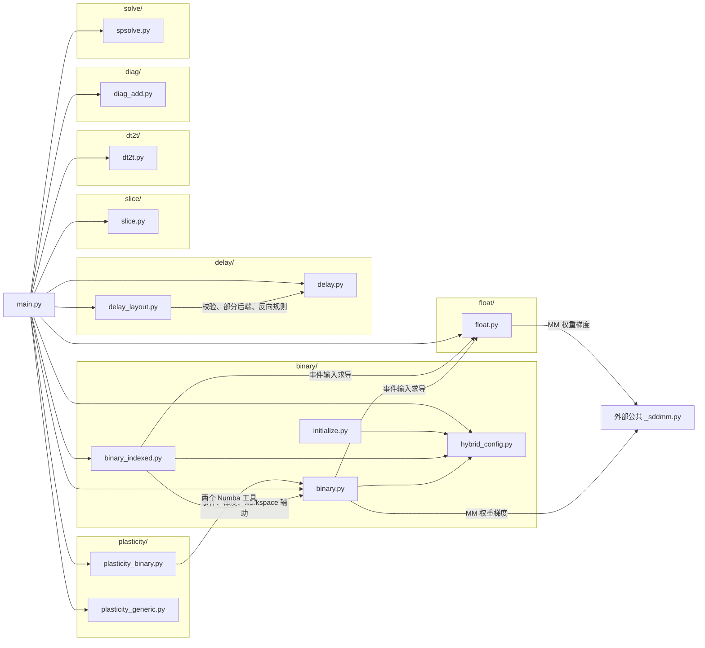
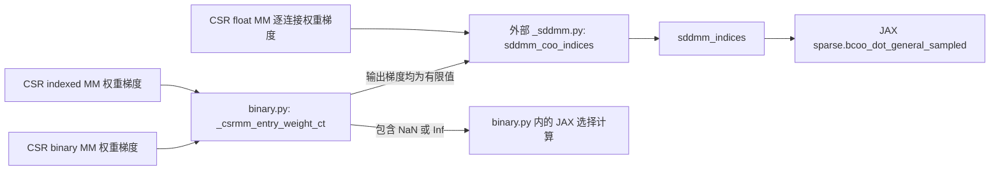

# CSR 文件组织与依赖关系

本文根据本地 `be0.3/brainevent/_csr` 的实际代码整理，记录时间为 2026-10-25。
文件组织已按下述结构实施。源码链接指向迁移后的本地位置；计算实现与调用关系保持原样。

## 1. 已确定的范围与约束

- 按功能归拢入口封装、调用分发、计算实现、求导与批处理规则、功能内的测试。
- 保留现有调用者、被调用者、函数语义、后端选择和调用条件。目录划分不代表消除现有功能间依赖。
- 使用整文件归类。`main.py` 的 workspace 管理仍在该文件；不拆出或复制其中的函数。
- 全局 `_misc.py` 的结构转换、索引处理、`build_sub_csr` 等仍在原文件。
- SDDMM 保持为 CSR 外部的公共机制：`brainevent/_sddmm.py`。不在 CSR 内新建 SDDMM 实现或分发层。
- 本文不规划 TCSR 的实现或接入。现有 `dev/` 内容原样保留，不纳入正式功能目录。
- 实施仅移动整文件并调整导入、资源定位与测试路径；不修改计算逻辑或既有功能间的依赖关系。

## 2. 功能边界

| 目录 | 负责的功能 | 内部包含 | 当前需要保留的依赖 |
| --- | --- | --- | --- |
| `binary/` | 二值和带权事件乘法 | 普通/indexed、MV/MM、hybrid 实现、配置与调优 | 事件输入求导调用 `float`；MM 权重梯度使用外部公共 SDDMM |
| `float/` | 普通数值乘法 | MV/MM、对应计算实现与变换规则 | MM 的逐连接权重梯度使用外部公共 SDDMM |
| `delay/` | 逐连接延迟投递 | 直接投递、预构建布局投递 | `delay_layout.py` 复用 `delay.py` 的输入处理、部分后端和反向规则 |
| `slice/` | 当前 `slice.py` 实现的行提取 | 稠密行结果的前向和反向算子 | 稀疏子矩阵接口仍由 `main.py → _misc.build_sub_csr` 完成，不改接到这里 |
| `dt2t/` | 节点数据与权重的逐连接运算 | 向量/批量接口、不同方向的计算 | 依赖公共框架及类型工具，无其他 CSR 主要功能调用 |
| `plasticity/` | 可塑性更新 | 固定事件规则、用户自定义逐连接规则 | `plasticity_binary.py` 继续从 `binary.py` 引用两个 Numba 工具 |
| `diag/` | 添加对角线 | 结构规划、数值更新 | 主要使用 Numba/JAX，没有独立的多后端 primitive 分发 |
| `solve/` | 稀疏线性求解接口 | 单位处理、外部求解器封装 | 继续调用 `jax.experimental.sparse.linalg.spsolve` |
| `_support/` | CSR 共用的结构计算文件 | `csr_to_csc.cu` | Python 调用方仍为外部 `_misc.py` |
| 根目录 | 对外对象及共享测试设施 | `main.py`、导出、共享测试工具 | `main.py` 继续协调各功能及公共结构工具 |

`binary_indexed` 与 `binary` 是同一功能的实现分支；`delay_layout` 与 `delay`
是同一投递功能的两种入口；固定可塑性与自定义规则统一归属 `plasticity`。
二值/带权、MV/MM、正向/转置不分别建立顶层功能目录。

## 3. 目标目录结构

功能目录中的 `__init__.py` 直接导出原实现对象，不包含新的计算或分发逻辑。
`_support/` 只存放计算源文件，不新增 Python 公共工具实现。

```text
brainevent/_csr/
├── .gitignore
├── __init__.py
├── main.py
├── _test_util.py
├── test/
│   ├── __init__.py
│   ├── _test_util_test.py
│   └── main_test.py
├── binary/
│   ├── __init__.py
│   ├── binary.py
│   ├── binary_csrmm.cu
│   ├── binary_csrmm_hybrid.cu
│   ├── binary_csrmv.cu
│   ├── binary_csrmv_hybrid.cu
│   ├── binary_indexed.py
│   ├── binary_indexed_csrmm.cu
│   ├── binary_indexed_csrmm_hybrid.cu
│   ├── binary_indexed_csrmv.cu
│   ├── binary_indexed_csrmv_hybrid.cu
│   ├── hybrid_config.py
│   ├── initialize.py
│   └── test/
│       ├── __init__.py
│       ├── binary_indexed_test.py
│       ├── binary_test.py
│       ├── hybrid_config_test.py
│       └── initialize_test.py
├── float/
│   ├── __init__.py
│   ├── float.py
│   ├── float_csrmm.cu
│   ├── float_csrmv.cu
│   └── test/
│       ├── __init__.py
│       └── float_test.py
├── delay/
│   ├── __init__.py
│   ├── csr_delay_deliver.cu
│   ├── csr_delay_deliver_layout.cu
│   ├── delay.py
│   ├── delay_layout.py
│   └── test/
│       ├── __init__.py
│       ├── delay_layout_test.py
│       └── delay_test.py
├── slice/
│   ├── __init__.py
│   ├── slice.py
│   ├── slice_csr_slice_rows.cu
│   └── test/
│       ├── __init__.py
│       └── slice_test.py
├── dt2t/
│   ├── __init__.py
│   ├── dt2t.cu
│   ├── dt2t.py
│   └── test/
│       ├── __init__.py
│       └── dt2t_test.py
├── plasticity/
│   ├── __init__.py
│   ├── plasticity_binary.py
│   ├── plasticity_binary_on_post.cu
│   ├── plasticity_binary_on_pre.cu
│   ├── plasticity_generic.py
│   └── test/
│       ├── __init__.py
│       ├── plasticity_binary_test.py
│       └── plasticity_generic_test.py
├── diag/
│   ├── __init__.py
│   ├── diag_add.py
│   └── test/
│       ├── __init__.py
│       └── diag_add_test.py
├── solve/
│   ├── __init__.py
│   └── spsolve.py
├── _support/
│   └── csr_to_csc.cu
└── dev/
    ├── csr-structure-plan.md
    ├── docs/                    # 本地开发文档
    └── delay_mv/                # 原有实验文件
```

共享测试工具 `_test_util.py` 仍留在根目录；测试用例统一进入各功能的 `test/`。
对象层和共享工具的测试进入根目录下的 `test/`，各测试包用 `__init__.py` 区分完整模块名。
当前没有独立的 `spsolve_test.py`，目录树不虚构该文件。

## 4. 原文件与目标位置

以下路径均相对于 `brainevent/_csr/`。清单覆盖迁移前根目录的 30 个 Python 文件和
17 个 CUDA 文件，不包含缓存、已有实验文件和本文档。每个现有文件只有一个目标位置。

| 原文件（链接到当前位置） | 当前相对路径 |
| --- | --- |
| [__init__.py](../__init__.py) | `__init__.py` |
| [main.py](../main.py) | `main.py` |
| [main_test.py](../test/main_test.py) | `test/main_test.py` |
| [_test_util.py](../_test_util.py) | `_test_util.py` |
| [_test_util_test.py](../test/_test_util_test.py) | `test/_test_util_test.py` |
| [binary.py](../binary/binary.py) | `binary/binary.py` |
| [binary_test.py](../binary/test/binary_test.py) | `binary/test/binary_test.py` |
| [binary_indexed.py](../binary/binary_indexed.py) | `binary/binary_indexed.py` |
| [binary_indexed_test.py](../binary/test/binary_indexed_test.py) | `binary/test/binary_indexed_test.py` |
| [hybrid_config.py](../binary/hybrid_config.py) | `binary/hybrid_config.py` |
| [hybrid_config_test.py](../binary/test/hybrid_config_test.py) | `binary/test/hybrid_config_test.py` |
| [initialize.py](../binary/initialize.py) | `binary/initialize.py` |
| [initialize_test.py](../binary/test/initialize_test.py) | `binary/test/initialize_test.py` |
| [binary_csrmv.cu](../binary/binary_csrmv.cu) | `binary/binary_csrmv.cu` |
| [binary_csrmv_hybrid.cu](../binary/binary_csrmv_hybrid.cu) | `binary/binary_csrmv_hybrid.cu` |
| [binary_csrmm.cu](../binary/binary_csrmm.cu) | `binary/binary_csrmm.cu` |
| [binary_csrmm_hybrid.cu](../binary/binary_csrmm_hybrid.cu) | `binary/binary_csrmm_hybrid.cu` |
| [binary_indexed_csrmv.cu](../binary/binary_indexed_csrmv.cu) | `binary/binary_indexed_csrmv.cu` |
| [binary_indexed_csrmv_hybrid.cu](../binary/binary_indexed_csrmv_hybrid.cu) | `binary/binary_indexed_csrmv_hybrid.cu` |
| [binary_indexed_csrmm.cu](../binary/binary_indexed_csrmm.cu) | `binary/binary_indexed_csrmm.cu` |
| [binary_indexed_csrmm_hybrid.cu](../binary/binary_indexed_csrmm_hybrid.cu) | `binary/binary_indexed_csrmm_hybrid.cu` |
| [float.py](../float/float.py) | `float/float.py` |
| [float_test.py](../float/test/float_test.py) | `float/test/float_test.py` |
| [float_csrmv.cu](../float/float_csrmv.cu) | `float/float_csrmv.cu` |
| [float_csrmm.cu](../float/float_csrmm.cu) | `float/float_csrmm.cu` |
| [delay.py](../delay/delay.py) | `delay/delay.py` |
| [delay_test.py](../delay/test/delay_test.py) | `delay/test/delay_test.py` |
| [delay_layout.py](../delay/delay_layout.py) | `delay/delay_layout.py` |
| [delay_layout_test.py](../delay/test/delay_layout_test.py) | `delay/test/delay_layout_test.py` |
| [csr_delay_deliver.cu](../delay/csr_delay_deliver.cu) | `delay/csr_delay_deliver.cu` |
| [csr_delay_deliver_layout.cu](../delay/csr_delay_deliver_layout.cu) | `delay/csr_delay_deliver_layout.cu` |
| [slice.py](../slice/slice.py) | `slice/slice.py` |
| [slice_test.py](../slice/test/slice_test.py) | `slice/test/slice_test.py` |
| [slice_csr_slice_rows.cu](../slice/slice_csr_slice_rows.cu) | `slice/slice_csr_slice_rows.cu` |
| [dt2t.py](../dt2t/dt2t.py) | `dt2t/dt2t.py` |
| [dt2t_test.py](../dt2t/test/dt2t_test.py) | `dt2t/test/dt2t_test.py` |
| [dt2t.cu](../dt2t/dt2t.cu) | `dt2t/dt2t.cu` |
| [plasticity_binary.py](../plasticity/plasticity_binary.py) | `plasticity/plasticity_binary.py` |
| [plasticity_binary_test.py](../plasticity/test/plasticity_binary_test.py) | `plasticity/test/plasticity_binary_test.py` |
| [plasticity_generic.py](../plasticity/plasticity_generic.py) | `plasticity/plasticity_generic.py` |
| [plasticity_generic_test.py](../plasticity/test/plasticity_generic_test.py) | `plasticity/test/plasticity_generic_test.py` |
| [plasticity_binary_on_pre.cu](../plasticity/plasticity_binary_on_pre.cu) | `plasticity/plasticity_binary_on_pre.cu` |
| [plasticity_binary_on_post.cu](../plasticity/plasticity_binary_on_post.cu) | `plasticity/plasticity_binary_on_post.cu` |
| [diag_add.py](../diag/diag_add.py) | `diag/diag_add.py` |
| [diag_add_test.py](../diag/test/diag_add_test.py) | `diag/test/diag_add_test.py` |
| [spsolve.py](../solve/spsolve.py) | `solve/spsolve.py` |
| [csr_to_csc.cu](../_support/csr_to_csc.cu) | `_support/csr_to_csc.cu` |

## 5. 功能文件依赖图

分组名表示目标目录，节点表示现有文件。箭头表示调用或使用，包含求导、特定后端
以及注册计算函数时的依赖；并不表示每次前向执行都会经过该边。
公共框架、类型和检查工具在第 8 节另列。



根目录 `__init__.py` 是导出层：保留 CSR/CSC、各运算接口、primitive、配置入口等
已有对外名称。它的导入和导出关系不表示每个功能都由 `main.py` 调用，例如
`initialize.py` 可以经公开入口单独使用。

## 6. main.py 调用的具体功能

| 目标文件 | 当前调用的函数或对象 | 用途 |
| --- | --- | --- |
| `binary/binary.py` | `binary_csrmv`、`binary_csrmm` | CSR/CSC 的事件乘法 |
| `binary/binary_indexed.py` | `binary_csrmv_indexed`、`binary_csrmm_indexed` | 使用镜像结构与 `perm` 的事件乘法分支 |
| `binary/hybrid_config.py` | `hybrid_task_capacity` | `main.py` 内 workspace 的容量计算 |
| `float/float.py` | `csrmv`、`csrmm` | 普通数值乘法 |
| `plasticity/plasticity_binary.py` | `update_csr_on_binary_pre`、`update_csr_on_binary_post` | 固定规则的 pre/post 更新；CSC 方法也复用这两个函数 |
| `plasticity/plasticity_generic.py` | `csr_apply_on_pre`、`csr_apply_on_post` | 用户自定义连接状态更新 |
| `delay/delay.py` | `csr_delay_deliver` | 向到达缓冲区投递事件 |
| `delay/delay_layout.py` | `CSRDelayLayout.build` | 建立延迟布局 |
| `slice/slice.py` | `csr_slice_rows` | `__getitem__` 返回稠密行数据 |
| `dt2t/dt2t.py` | `csrmv_dt2t` | `dt2t` 与 `dt2t_transposed`，通过参数区分方向 |
| `diag/diag_add.py` | `csr_diag_position`、`csr_diag_add` | 规划对角结构并更新数值 |
| `solve/spsolve.py` | `csr_solve` | CSR 求解接口 |
| 外部 `_misc.py` | `normalize_row_index`、`build_sub_csr` | `slice_rows` 返回稀疏子矩阵，保持原调用链 |

## 7. 功能之间及同目录内部的复用

### 7.1 跨功能目录

| 调用方 → 目标文件 | 使用的功能 | 条件与说明 |
| --- | --- | --- |
| `binary/binary.py → float/float.py` | `csrmv`、`csrmm` | 事件输入的 JVP 和反向梯度；事件前向本身不因此转成 float 路径 |
| 同上 | `csrmv_p`、`csrmm_p` | `_grad_backend` 查询可用后端；不是重新定义乘法 |
| `binary/binary_indexed.py → float/float.py` | `csrmv`、`csrmm` | indexed 事件输入的 JVP 和反向梯度 |
| `plasticity/plasticity_binary.py → binary/binary.py` | `_EVENT_FASTMATH`、`_numba_event_mask` | Numba 编译选项和事件类型处理；保留现有导入，不改为直引公共工具 |

`delay`、`slice`、`dt2t`、`diag`、`solve`、`plasticity_generic` 的现有实现没有调用
其他 CSR 主要功能的计算入口。它们仍有第 8 节列出的公共框架或外部库依赖。

### 7.2 功能目录内部

| 调用方 → 目标文件 | 使用的功能 |
| --- | --- |
| `binary_indexed.py → binary.py` | `_event_contrib`、`_entry_weight_ct`、`_csrmm_entry_weight_ct`：事件贡献和权重梯度 |
| 同上 | `_workspace_task_operands`、`_workspace_from_task_operands`：workspace 处理 |
| 同上 | `_EVENT_FASTMATH`、`_numba_event_mask`、`_numba_weighted_events`：Numba 与类型适配 |
| `binary.py`、`binary_indexed.py → hybrid_config.py` | `get_hybrid_config`、`compile_flags_for_config`、`module_suffix_for_config` |
| `binary.py → hybrid_config.py` | `hybrid_task_capacity` |
| `initialize.py → hybrid_config.py` | `HybridConfig`、`validate_config`、`compile_flags_for_config`、`module_suffix_for_config`、`current_device_kind`、`save_hybrid_config` |
| `delay_layout.py → delay.py` | `_check_concrete_delays`、`_normalize_operands`、`_resolve_event_mode`：校验和输入处理 |
| 同上 | `_jax_kernel`、`_numba_kernel_generator`：复用后端实现，经过 layout 侧的参数适配 |
| 同上 | `_transpose_rule`：复用反向传播规则 |

`initialize.py` 是显式调优入口，普通乘法运行不会自动执行它。
`plasticity_generic.py` 不调用 `plasticity_binary.py`，两者按功能归组但保留各自实现。

## 8. CSR 外部公共机制

| 公共文件 | 当前使用者 | 使用的功能 |
| --- | --- | --- |
| [_event/dispatch.py](../../_event/dispatch.py) | `main.py`、`delay.py`、`delay_layout.py` | `as_event_operand`：事件类型识别，返回数值及模式 |
| [_sddmm.py](../../_sddmm.py) | `binary.py`、`float.py` | `sddmm_coo_indices`；indexed MM 通过 binary 的辅助函数间接复用 |
| [_misc.py](../../_misc.py) | `main.py` | `_as_int32_indices`、`_as_indptr`、`_check_compressed_structure`、`_csr_to_coo`、`_csr_todense`、CSR/CSC 索引转换、行索引规范化、`build_sub_csr` |
| 同上 | `binary.py`、`binary_indexed.py`、`float.py` | 结构类型检查、`_csr_to_coo`、`namescope` |
| 同上 | `delay.py`、`delay_layout.py`、`slice.py`、`dt2t.py`、`plasticity_binary.py` | 按需使用结构类型检查、`namescope`；可塑性另使用 `csc_to_csr_index` |
| 同上 | `diag_add.py` | `MatrixShape`、`_INT32_MAX` |
| [_op/main.py](../../_op/main.py) | binary、indexed、float、delay、delay_layout、slice、dt2t、plasticity_binary | `XLACustomKernel`：后端与变换规则注册、调用分发 |
| [_op/kernix_pipeline.py](../../_op/kernix_pipeline.py) | 具有 CUDA 实现的模块、`initialize.py`、外部 `_misc.py` | `load_cuda_file`：编译与加载 |
| 同上 | `hybrid_config.py` | `get_cache_dir`：配置文件存储目录 |
| [_op/numba_ffi.py](../../_op/numba_ffi.py) | binary、indexed、float、delay、slice、dt2t、plasticity_binary | `numba_kernel`；delay_layout 经 delay 的函数间接复用 |
| [_op/util.py](../../_op/util.py) | 各运算模块按需使用 | `general_batching_rule`、`dtype_suffix`、`cuda_event_abi`、`event_active`、`event_factor`、`select_active`、Numba 事件工具 |
| [_op/benchmark.py](../../_op/benchmark.py) | 注册 benchmark 的运算模块 | `BenchmarkConfig` |
| [_data.py](../../_data.py) | `main.py` | `DataRepresentation` 基类 |
| [_typing.py](../../_typing.py) | 相关接口模块 | 数据、索引、shape 等类型定义 |
| [_compatible_import.py](../../_compatible_import.py) | `delay.py`、`delay_layout.py` | `Tracer` 类型检查 |
| [config.py](../../config.py) | `binary.py`、`binary_indexed.py`、`float.py` | `get_numba_parallel` |
| JAX 稀疏求解模块 | `spsolve.py` | `jax.experimental.sparse.linalg.spsolve` |

基础库 JAX、NumPy、brainunit、Numba 和标准库依赖不逐函数展开。
`diag_add.py` 自己包含 Numba 结构规划与 JAX 数值更新；`plasticity_generic.py`
使用 JAX 规则执行与选择。两者不使用 `XLACustomKernel` 分发。

### 公共 SDDMM 的当前边界



该机制保持在 CSR 外部。它是 JAX 实现，也可以在 GPU 上执行。CSR 的 MV
逐连接权重梯度主要在各自模块中通过 JAX 索引和逐元素计算完成；共享标量权重
的一些分支复用前向乘法再归约，不能将所有权重梯度都画成经过 `_sddmm.py`。

## 9. Python 分发到计算文件

| Python 调用方 | 加载的文件 | 目标目录 |
| --- | --- | --- |
| `binary.py` | `binary_csrmv.cu`、`binary_csrmv_hybrid.cu`、`binary_csrmm.cu`、`binary_csrmm_hybrid.cu` | `binary/` |
| `binary_indexed.py` | 上述 4 个普通文件，以及 `binary_indexed_csrmv.cu`、`binary_indexed_csrmv_hybrid.cu`、`binary_indexed_csrmm.cu`、`binary_indexed_csrmm_hybrid.cu` | `binary/` |
| `initialize.py` | `binary_csrmv_hybrid.cu`，通过 FFI 直接测评 | `binary/` |
| `float.py` | `float_csrmv.cu`、`float_csrmm.cu` | `float/` |
| `delay.py` | `csr_delay_deliver.cu` | `delay/` |
| `delay_layout.py` | `csr_delay_deliver_layout.cu` | `delay/` |
| `slice.py` | `slice_csr_slice_rows.cu`，前向与反向共用此源文件 | `slice/` |
| `dt2t.py` | `dt2t.cu`，MV/MM 共用此源文件 | `dt2t/` |
| `plasticity_binary.py` | `plasticity_binary_on_pre.cu`、`plasticity_binary_on_post.cu` | `plasticity/` |
| 外部 `_misc.py` | `csr_to_csc.cu` | `_support/` |

CUDA 源文件继续使用现有公共头文件，例如 `include/cuda_common.h`、
`include/brainevent/common.h`。文件组织不改变其中的算法、导出符号或 FFI 参数。

## 10. 测试与路径关系

- 各功能测试放在对应的 `test/` 子目录，保留 `foo_test.py` 文件名；共移动 14 个现有测试文件。
- 根目录保留 `_test_util.py`；`_test_util_test.py` 和 `main_test.py` 放入 `_csr/test/`。
- `binary_test.py`、`binary_indexed_test.py` 仍使用 `main.py` 中的 workspace 辅助函数。
- `delay/test/delay_layout_test.py` 通过新的完整路径复用 `delay/test/delay_test.py` 的 `make_csr`、`make_events`、`reference`。
- `test/main_test.py` 仍为对象层及跨功能行为测试；与 `binary/test/hybrid_config_test.py` 一起调整了基于测试位置的 CUDA 源文件定位。CSR 全目录扫描继续排除 `dev/`。
- 现有通过模块对象 monkeypatch、`__file__`、`with_name`、`parent` 定位计算源文件的测试，需要随路径迁移保持指向原实现，不能误指到仅做导出的包入口。

已落实的路径调整与兼容边界：

1. 更新 Python 导入路径及包导出映射，保持实际被调用函数与调用条件不变。
2. 更新计算文件定位路径。外部 `_misc.py` 已改为定位 `_csr/_support/csr_to_csc.cu`，仍加载同一份源文件。
3. 保持 Python 接口、primitive 名称、后端注册、CUDA 模块名和 FFI 目标不变。
4. 保持 `brainevent` 和 `brainevent._csr` 的公共导出。`binary`、`float`、`delay`、`slice`、`dt2t` 包继续导出原模块的 `__all__` 名称；私有辅助函数及其他迁移模块使用第 4 节对应的新完整模块路径，不增加旧路径别名。
5. 验证覆盖导入、源文件定位、跨目录依赖、受影响的现有测试及 wheel 中的资源。具体运行结果见实施记录。

现有 `dev/` 实验文件及其历史引用维持现状，不在这份正式 CSR 目录方案中改接。

## 11. 本地实施记录

- 工作分支：`csr-layout`，基于 `main` 的 `f0f93b1`（0.3.0），没有上游分支，不推送远端。
- 迁移前本地快照：`backup/be0.3-before-layout`（`fe47c43`）；原本与远端 main 不同的工作区内容继续保留。
- 实施规格：[2026-10-25-csr-layout.md](docs/specs/2026-10-25-csr-layout.md)。
- 测试子目录调整：[2026-10-25-csr-test-layout.md](docs/specs/2026-10-25-csr-test-layout.md)，按用户最新要求覆盖此前的同目录测试约定。
- `dev/` 由 `_csr/.gitignore` 排除，保留本地文件；仓库 `docs/` 已复制至 `dev/docs/`，原目录保留。
- 文档归类更新（2026-10-26）：上述两份 CSR 布局规格统一以 `dev/docs/specs/` 中的版本为准，
  已核对内容并移除公共 `docs/specs/` 下的重复副本；各数据结构方案的引用同步指向这里。
  其他历史文档快照保留。各家族的当前布局入口见 [文档索引](../../../docs/specs/file-layout-index.md)。
- 例如原 `brainevent._csr.binary_indexed` 现在是 `brainevent._csr.binary.binary_indexed`；
  原 `brainevent._csr.binary` 中的实现及私有辅助函数现在位于 `brainevent._csr.binary.binary`。
- `_fcn/main.py` 的导入同步指向移动后的原函数；TCSR 的 `csr_slice_rows` 导入由新 `slice` 包直接导出兼容。

### 验证结果（2026-10-25）

- 使用临时隔离的 Python 3.12 环境，JAX/JAXLIB 0.12.0.1，`JAX_PLATFORMS=cpu`；没有改动原 Python 环境。
- 运行现有 CSR 测试（排除 `dev`）、`_misc_test.py` 和 `_fcn/main_test.py`：
  **636 passed、79 skipped、2080 deselected**。遵循仓库默认的 `not slow` 选择；GPU 执行和被排除的慢后端不在本轮验证范围。
- 两条 warning 来自已有测试主动 reload indexed 模块，重新注册同名 primitive；正常导入的注册表与原版一致。
- `mypy --no-site-packages`：**107 个源码文件，0 错误**；同设置下迁移前基线为 99 个文件、0 错误。
- 按文件映射统一导入路径后，17 个 Python 实现/调用文件的 AST 与迁移前一致；17 个 CUDA 源文件逐字节一致。
- Wheel 构建、独立目录安装与导入通过；47 个原文件及 8 个新增包入口全部入包，旧迁移路径不再入包。
- 已安装的 wheel 中，17 个 CUDA 资源定位有效，公共导出和 57 个 primitive 注册项与迁移前一致；包导出仍引用实现中的同一对象。
- 按迁移前原工作区 SHA256 复核，300 个非本轮修改文件（含仅移动的 CUDA 文件）内容一致；SDDMM、TCSR 与原有实验代码未修改。
- 分支工作区保留本次迁移及原有本地差异，尚未提交；没有执行远端推送。

可复现的主要检查命令（在 `be0.3/` 下，使用具有运行依赖的隔离环境）：

```bash
JAX_PLATFORMS=cpu python -m pytest brainevent/_csr brainevent/_misc_test.py brainevent/_fcn/main_test.py --ignore=brainevent/_csr/dev -q
python -m mypy --no-site-packages
python -m build --wheel
```

### 测试子目录调整后的验证

- 14 个正式测试文件进入 8 个 `test/` 包；原 2503 个测试用例的收集结果按路径映射后完全一致。
- 11 个测试文件原样移动，另外 3 个仅调整共享测试函数导入或源码定位；计算与分发源码逐字节保持不变。
- CSR CPU 回归：**499 passed、79 skipped、1925 deselected**，仍使用默认 `not slow` 选择。
- `mypy --no-site-packages`：**116 个源码文件，0 错误**。`dev/` 继续被 Git 忽略，分支未提交、未推送。
