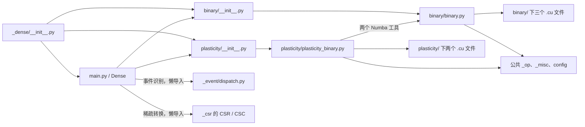

# Dense 文件组织与迁移方案

更新日期：2026-10-26。状态：文件迁移及 CPU、类型检查、安装包验证已完成。

采用与 CSR 一致的组织方式：**根目录保留对象层，计算实现按功能归组，测试进入对应的
`test/`，开发文档放在 `dev/`。** 本次迁移以完整文件为单位，保持现有计算逻辑和调用关系。

参考：[CSR 功能目录方案](../../_csr/dev/docs/specs/2026-10-25-csr-layout.md)、
[CSR 测试目录方案](../../_csr/dev/docs/specs/2026-10-25-csr-test-layout.md)。

## 1. 功能职责与划分依据

迁移前共有 **4 个生产 Python 文件、3 个测试文件、5 个 CUDA 文件**；
本次新增 2 个功能包和 3 个测试包的初始化文件。三份测试文件仍包含 71 个 `test_*`
函数或方法，在本次 CPU 环境中完整收集到 664 个参数化用例。

| 层级 | 职责 | 文件归属 |
| --- | --- | --- |
| 对象与导出层 | `Dense` 数据对象、普通数值操作、功能调用与对外导出 | 根目录 `main.py`、`__init__.py` |
| 事件乘法 | 二值及带权事件 MV/MM，含各后端、求导、批处理、benchmark 注册 | `binary/`：`binary.py` 和三个 CUDA 文件 |
| 可塑性更新 | pre/post 事件更新，含各后端、求导、批处理、benchmark 注册 | `plasticity/`：`plasticity_binary.py` 和两个 CUDA 文件 |
| 测试 | 分别验证对象层、事件乘法和可塑性更新 | 根目录、`binary/`、`plasticity/` 各自的 `test/` |
| 开发文档 | 结构方案与迁移记录 | `dev/`，当前仅含本文档 |

`main.py` 保留以下对象功能，它们目前直接操作底层数组或调用现有外部接口：

| 对象功能 | 入口与实现方式 |
| --- | --- |
| 数据与元数据 | 单位、shape/backend/buffers、pytree、`fromdense`、`todense`、`with_data` |
| 逐元素运算 | `apply`、`apply2`、算术运算符 |
| 普通数值 MV/MM | 类型提升后执行 `data @ other` 或 `other @ data` |
| 事件运算分发 | 按秩调用 `binary_densemv` / `binary_densemm`，通过 `weighted` 区分二值和带权事件 |
| 可塑性对象封装 | `update_on_pre` / `update_on_post` 调用对应的 `update_dense_on_binary_*` |
| 索引与结构操作 | `__getitem__`、`slice_rows`、`transpose`、`diag_add` |
| 稠密线性求解 | `solve` 调用 `jnp.linalg.solve` |
| 稀疏转换 | `tocsr` / `tocsc` 懒导入 CSR/CSC，`tocoo` 复用 CSR 转换 |
| 协议占位 | `dt2t` / `dt2t_transposed` 当前抛出 `NotImplementedError` |

MV 的批处理规则会转调 MM，二者共用事件处理、非有限值隔离和 cuBLAS 加载工具，
因此 `binary.py` 整体迁入 `binary/`。二值/带权、MV/MM、求导及各后端继续放在同一实现文件。
pre/post 更新整体迁入 `plasticity/`，对象封装仍留在 `main.py`。

当前没有独立的 Dense float、slice、diag、solve、dt2t 实现文件，也没有 Dense 专用共享
测试工具。因此功能目录确定为 `binary/` 和 `plasticity/`，共享测试工具继续使用包级
`brainevent/_test_util.py`。进一步拆分函数或抽取公共模块另行评估。

## 2. 当前目录

```text
brainevent/_dense/
├── __init__.py
├── main.py
├── test/
│   ├── __init__.py
│   └── main_test.py
├── binary/
│   ├── __init__.py
│   ├── binary.py
│   ├── binary_densemv.cu
│   ├── binary_densemm.cu
│   ├── binary_dense_cublas.cu
│   └── test/
│       ├── __init__.py
│       └── binary_test.py
├── plasticity/
│   ├── __init__.py
│   ├── plasticity_binary.py
│   ├── plasticity_binary_on_pre.cu
│   ├── plasticity_binary_on_post.cu
│   └── test/
│       ├── __init__.py
│       └── plasticity_binary_test.py
└── dev/
    └── dense-structure-plan.md
```

功能包的 `__init__.py` 直接导出已有实现对象；测试包的 `__init__.py` 用于区分
完整测试模块名，避免与 CSR 等目录中的同名测试冲突。
`dev/` 保存开发文档，不添加 Python 包初始化文件，也不承担运行时功能。

## 3. 文件迁移清单

路径相对于 `brainevent/_dense/`。已移动 10 个现有文件，新增 5 个包初始化文件。
以下映射覆盖迁移前全部 12 个 Python/CUDA 文件；文档不计入源码移动数量。

| 迁移前路径 | 当前路径 |
| --- | --- |
| `__init__.py` | `__init__.py`，调整导出来源 |
| `main.py` | `main.py`，调整内部导入 |
| `main_test.py` | `test/main_test.py` |
| `binary.py` | `binary/binary.py` |
| `binary_densemv.cu` | `binary/binary_densemv.cu` |
| `binary_densemm.cu` | `binary/binary_densemm.cu` |
| `binary_dense_cublas.cu` | `binary/binary_dense_cublas.cu` |
| `binary_test.py` | `binary/test/binary_test.py` |
| `plasticity_binary.py` | `plasticity/plasticity_binary.py` |
| `plasticity_binary_on_pre.cu` | `plasticity/plasticity_binary_on_pre.cu` |
| `plasticity_binary_on_post.cu` | `plasticity/plasticity_binary_on_post.cu` |
| `plasticity_binary_test.py` | `plasticity/test/plasticity_binary_test.py` |

新增初始化文件：`binary/__init__.py`、`plasticity/__init__.py`、`test/__init__.py`、
`binary/test/__init__.py`、`plasticity/test/__init__.py`。

已同步将 `AGENTS.md` 第 11 条的功能内 `test/` 规则从 CSR 扩展到 Dense，
继续使用 `*_test.py` 命名，其他包的规则保持现状。

## 4. 依赖与兼容约束

### 4.1 功能依赖



`_event/binary.py`、`_event/weighted.py`、`_event/bitpack_binary.py` 通过
`brainevent._dense` 获取乘法入口。继续保留根导出和事件识别的懒导入，维持现有初始化关系。

可塑性继续从事件乘法实现引用 `_EVENT_FASTMATH`、`_numba_event_mask`，它们分别
引用公共 `_op.util` 的 `NUMBA_EVENT_FASTMATH`、`numba_event_mask`。此次只调整导入路径。

### 4.2 导出与导入路径

- `brainevent` 与 `brainevent._dense.__all__` 的现有 9 个 Dense 相关名称保持不变。
- 根包当前还可显式导入 `binary_densemv_p_call`、`binary_densemm_p_call`，虽然它们
  没有列入根 `__all__`，也应保留这两个属性。
- `binary/__init__.py` 转导出两个乘法函数、两个 primitive 和两个 `*_p_call`。
  `plasticity/__init__.py` 转导出两个更新函数及对应 primitive。
- `main.py` 从 `.binary` 和 `.plasticity` 功能包导入入口。
- 可塑性对两个私有 Numba 工具的引用改为
  `brainevent._dense.binary.binary`，直接指向实际实现模块。
- 原 `brainevent._dense.binary` 成为功能包；上述六个显式入口继续可用。
  私有实现及模块级替换操作使用 `brainevent._dense.binary.binary`。
- 原 `brainevent._dense.plasticity_binary` 迁到
  `brainevent._dense.plasticity.plasticity_binary`。与 CSR 同样记录私有路径变更，
  不增加旧模块别名或兼容转发文件。

四个 primitive 的名称、对象唯一性、后端顺序、默认值、tags、benchmark 和变换注册
保持原样：`binary_densemv`、`binary_densemm`、`dense_on_pre`、`dense_on_post`。

| 功能 | 实际注册的后端 |
| --- | --- |
| 事件乘法 MV/MM | Numba、`jax_raw`、`cuda_raw`、`cublas` |
| pre/post 可塑性 | Numba、`jax_raw`、`cuda_raw` |

可塑性 primitive 的旧 docstring 仍提到 `pallas`，属于既有文档偏差；目录和后端清单以
实际注册为准。各平台支持范围及默认选择沿用原实现。

### 4.3 测试模块与 monkeypatch

迁移前 `binary_test.py` 把 `brainevent._dense.binary` 绑定为 `dense_binary_mod`，
访问私有 kernel generator，并 monkeypatch 该模块的 `load_cuda_file`。
迁移后已让这个变量指向 `brainevent._dense.binary.binary`，确保替换的是实现函数使用的
模块全局变量。

`plasticity_binary_test.py` 的 primitive 导入使用新的实现路径；
`main_test.py` 中仅导入公开 primitive 的语句仍可使用 `brainevent._dense.binary`。
保留测试文件名、现有参数化和共享工具来源。

### 4.4 CUDA 资源与安装包

五个 CUDA 文件都由相邻 Python 实现通过 `Path(__file__).parent.joinpath(...)` 加载。
实现与资源成组移动后，加载表达式可以原样保留。五个编译模块名仍为
`dense_binary_mv`、`dense_binary_mm`、`dense_binary_cublas`、
`dense_plasticity_on_pre`、`dense_plasticity_on_post`。

当前 `pyproject.toml` 对所有发现的包设置了 `*.cu`、`*.h` package data。
新增功能包沿用该配置，已通过实际构建 wheel 和安装后定位验证。
cuBLAS 的库发现、链接参数和 `allow_cuda_graph=False` 保留原样。

原 MV/MM 加载测试只记录 `path.name`，不能发现文件移动后的目录错误。
本次在既有加载 mock 中增加 `path.is_file()` 检查，并核对了全部五个安装后资源位置。
CUDA 源码保持字节一致；其中 `binary_densemv.cu` 的 API 注释仍指向可用的功能包入口。

## 5. 实施顺序与验收要求

1. **保存基线。** 在工作分支记录当前文件内容、导出、primitive 注册及完整测试收集结果，
   保留已有 CSR 和其他工作区修改。
2. **执行迁移。** 按第 3 节移动完整文件、添加初始化文件、调整导入与测试规则；
   核查代码和文档中的旧私有路径，历史审计记录可保留历史路径。
3. **完成验收。** 按下表核对结果，记录实际执行环境、通过项与未覆盖范围。

| 验收项 | 通过标准 |
| --- | --- |
| 源码差异 | 五个 CUDA 文件字节一致；生产 Python 仅有导入、导出和必要路径文本变更 |
| 测试收集 | 在相同环境用 `-m ''` 完整收集，映射文件路径后无用例丢失或重复 |
| CPU 回归 | 现有 Dense 测试及 `_event/binary_test.py`、`_event/weighted_test.py`、`_registry_test.py` 通过 |
| 导出与注册 | 根包、功能包、实现模块的导出对象身份一致；四个 primitive 注册唯一，后端及默认值不变 |
| 对象与懒导入 | `Dense` pytree、元数据、单位及到 CSR/CSC 的转换可用 |
| 安装包 | 构建 wheel，在源码目录外验证安装后导入及全部五个 CUDA 资源位置 |
| 类型检查 | 运行现有 `mypy --no-site-packages` 检查，与迁移前基线比较 |
| GPU 回归 | 有 GPU 的环境验证 CUDA/cuBLAS 实际编译执行及 pre/post 更新 |

行为回归重点覆盖正向/转置 MV/MM、二值/带权事件、单位、JIT、JVP/VJP、vmap、
pre/post 更新，以及非活跃事件的 NaN/Inf 隔离。完整收集使用 `-m ''`，实际执行默认
CPU 回归时应单列被 `not slow` 筛选排除的变体。

CPU mock 仅验证加载参数和资源定位，GPU kernel 的执行结果以 GPU 实测为准。

## 6. 实施结果

实施于本地 `csr-layout` 工作分支，保留迁移前已有的 CSR 及其他工作区修改。
完成 10 个文件移动、5 个初始化文件新增、内部导入与根导出调整，以及测试目录规则更新。
`main_test.py` 原样移动；另外两份测试仅调整实现模块引用，乘法测试另增加资源存在性断言。

验证环境：Python 3.12.13，JAX/JAXLIB 0.12.0.1，`JAX_PLATFORMS=cpu`。
复用先前 CSR 验证的临时虚拟环境；wheel 采用独立构建环境，并安装到临时目录。

| 检查 | 实际结果 |
| --- | --- |
| 完整测试收集 | 迁移前后均为 664 个 Dense 用例，按文件映射逐项比较一致，无丢失或重复 |
| CPU 回归 | 439 passed、57 skipped、255 deselected；范围为 Dense、事件调用方和 registry 测试 |
| 类型检查 | `mypy --no-site-packages`：121 个源码文件，0 错误；迁移前基线为 116 个文件，0 错误 |
| 计算实现 | 五个 CUDA 文件、`binary.py` 字节一致；其余原有生产 Python 文件的 AST 仅导入不同 |
| 公共对象 | 保留 9 个根导出及两个低层 `*_p_call`；根包、功能包和实现模块引用同一对象 |
| primitive 注册 | 4 个 Dense primitive、全包 57 个 primitive 的注册名称一致；Dense 的 tags、各平台后端及默认值与基线一致 |
| wheel | `brainevent-0.3.0-py3-none-any.whl` 构建并安装成功，新路径齐全，旧源码路径未残留 |
| 安装后运行 | 在源码目录外验证导出、共享 Numba 工具引用、JIT 和 CSR/CSC 懒转换；五个 CUDA loader 的资源路径及文件内容均正确 |

CPU 回归中的一个 warning 来自既有 registry 测试主动覆盖注册的行为。
255 个慢速变体按仓库默认配置排除；GPU CUDA/cuBLAS 实际编译执行尚未验证。
安装后资源验证通过替换 loader 检查路径和内容，没有执行 GPU kernel。

本次使用的主要检查命令如下，其中 `python` 指上述临时验证环境：

```bash
JAX_PLATFORMS=cpu python -m pytest brainevent/_dense --collect-only -q -m ''
JAX_PLATFORMS=cpu python -m pytest brainevent/_dense brainevent/_event/binary_test.py brainevent/_event/weighted_test.py brainevent/_registry_test.py -q
python -m mypy --no-site-packages
python -m build --wheel
```

构建在当前源码的临时副本中进行。迁移前快照、映射及验证日志存放于本机
`/tmp/brainevent-dense-layout-y40hkqib/`，不作为运行时依赖。
