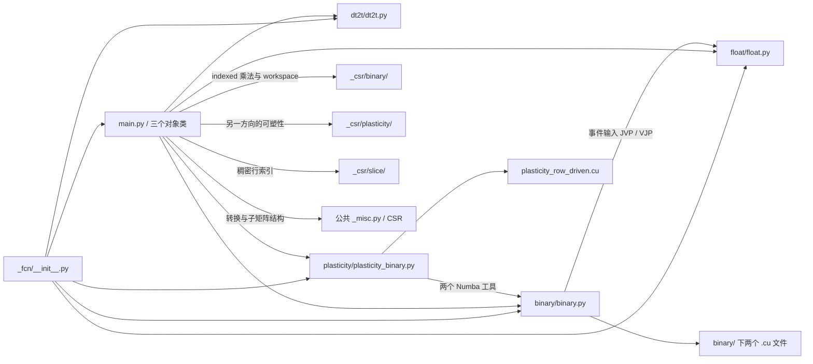

# FCN 文件组织与迁移方案

更新日期：2026-10-26。状态：文件迁移及 CPU、类型检查、安装包验证已完成；另记录一项迁移前已有的输出布局问题。

采用与 CSR、Dense 一致的组织方式：**根目录保留对象层，完整计算文件按功能归组，
测试进入对应的 `test/`，开发文档放在 `dev/`。** FCN 的计算功能划分为
`binary/`、`float/`、`dt2t/`、`plasticity/`，保留现有算法、分发条件和跨包依赖。

参考：[CSR 功能目录方案](../../_csr/dev/docs/specs/2026-10-25-csr-layout.md)、
[CSR 测试目录方案](../../_csr/dev/docs/specs/2026-10-25-csr-test-layout.md)、
[Dense 文件组织方案](../../_dense/dev/dense-structure-plan.md)。

## 1. 功能职责与划分依据

迁移前共有 **6 个生产 Python 文件、5 个测试文件、3 个 CUDA 文件**；
本次新增 4 个功能包和 5 个测试包的初始化文件。五份测试文件仍包含 173 个 `test_*`
函数或方法，在本次 CPU 环境中完整收集到 1,227 个参数化用例。

| 层级 | 职责与主要入口 | 文件归属 |
| --- | --- | --- |
| 对象与导出层 | `FixedNumConn`、`FixedNumPerPre`、`FixedNumPerPost`；对象元数据、单位、pytree、初始化、转换与运算路由 | 根目录 `main.py`、`__init__.py` |
| 事件乘法 | `binary_fcnmv`、`binary_fcnmm`；二值/带权事件、后端分发、求导、批处理与 benchmark 注册 | `binary/`：`binary.py`、两个 CUDA 文件 |
| 普通数值乘法 | `fcnmv`、`fcnmm`；纯 JAX gather/scatter，MM scatter 包含分块临时内存控制 | `float/`：`float.py` |
| 逐连接乘法 | `fcnmv_dt2t`、`fcnmm_dt2t`；按 ELL 连接槽位计算，含批量版本、单位与形状校验 | `dt2t/`：`dt2t.py` |
| 行驱动可塑性 | 两个 `update_fixed_*` 包装函数，共用 `fcn_plasticity_row_p` | `plasticity/`：`plasticity_binary.py`、一个 CUDA 文件 |
| 测试与文档 | 对象及四个功能的测试；开发方案 | 各自的 `test/`、根目录 `dev/` |

`float.py` 与 `dt2t.py` 都是完整的独立功能实现，适合按功能建包；两者使用 JAX 运算，
没有独立 CUDA 文件或 `XLACustomKernel` 注册。事件乘法和行驱动可塑性实际注册的后端
为 `numba`、`cuda_raw`、`jax_raw`，沿用各平台的支持范围和默认选择。
部分旧 docstring 提到 Pallas，目录设计以实际实现为准。

`binary.py` 中 MV 的批处理会调用 MM，MV/MM 共用事件工具和输出布局处理，
因此整体移动；二值/带权、MV/MM、gather/scatter 和各后端继续放在同一功能内。
`plasticity_binary.py` 的两个接口共用一个行驱动 primitive，也保持在同一文件。

`main.py` 保留以下内容：

| 对象层内容 | 保留原因 |
| --- | --- |
| 三个类及方向映射 | 共同描述固定连接数的 ELL 存储，统一协调逻辑矩阵方向与底层实现 |
| 初始化、索引检查、CSC 镜像、`perm` 缓存和 workspace | 与对象 buffers、pytree 及 JIT 外初始化约束直接关联 |
| 事件与普通数值乘法路由、输出形状对齐 | 决定何时调用本地 FCN 实现或 CSR indexed 实现 |
| `dt2t` / `dt2t_transposed` | 对象方法调用 `fcnmv_dt2t`；`fcnmm_dt2t` 仍作为独立公开函数提供 |
| pre/post 可塑性路由 | 按类与更新方向选择本地行驱动实现或复用 CSR 可塑性 |
| `fromdense`、COO/CSR/CSC 转换、索引、`slice_rows`、转置、逐元素运算和 `sum` | 已有对象方法及公共结构工具可完成这些操作 |

`_ell_from_rows`、两个 `fixed_*_num_to_coo` 辅助函数及 workspace 辅助函数继续留在
`main.py`。本次不拆出额外的 conversion、slice、workspace 或类专属目录。
共享测试工具继续使用 `brainevent/_test_util.py`，不新增 FCN `_support/` 或测试工具文件。

## 2. 当前目录

```text
brainevent/_fcn/
├── __init__.py
├── main.py
├── test/
│   ├── __init__.py
│   └── main_test.py
├── binary/
│   ├── __init__.py
│   ├── binary.py
│   ├── binary_fcnmv.cu
│   ├── binary_fcnmm.cu
│   └── test/
│       ├── __init__.py
│       └── binary_test.py
├── float/
│   ├── __init__.py
│   ├── float.py
│   └── test/
│       ├── __init__.py
│       └── float_test.py
├── dt2t/
│   ├── __init__.py
│   ├── dt2t.py
│   └── test/
│       ├── __init__.py
│       └── dt2t_test.py
├── plasticity/
│   ├── __init__.py
│   ├── plasticity_binary.py
│   ├── plasticity_row_driven.cu
│   └── test/
│       ├── __init__.py
│       └── plasticity_binary_test.py
└── dev/
    └── fcn-structure-plan.md
```

功能包直接转导出原实现对象，不新增计算包装或分发层。五个测试目录添加 `__init__.py`，
确保 pytest 使用完整模块名，避免与 CSR、Dense 等包中的同名测试冲突。
`dev/` 仅保存开发文档，不添加 Python 包初始化文件。

## 3. 文件迁移清单

以下路径相对于 `brainevent/_fcn/`，覆盖迁移前全部 14 个 Python/CUDA 文件。
已移动其中 12 个文件，新增 4 个功能包和 5 个测试包的初始化文件，共 9 个。

| 迁移前路径 | 当前路径 |
| --- | --- |
| `__init__.py` | `__init__.py`，调整导出来源 |
| `main.py` | `main.py`，调整内部导入 |
| `main_test.py` | `test/main_test.py` |
| `binary.py` | `binary/binary.py` |
| `binary_fcnmv.cu` | `binary/binary_fcnmv.cu` |
| `binary_fcnmm.cu` | `binary/binary_fcnmm.cu` |
| `binary_test.py` | `binary/test/binary_test.py` |
| `float.py` | `float/float.py` |
| `float_test.py` | `float/test/float_test.py` |
| `dt2t.py` | `dt2t/dt2t.py` |
| `dt2t_test.py` | `dt2t/test/dt2t_test.py` |
| `plasticity_binary.py` | `plasticity/plasticity_binary.py` |
| `plasticity_row_driven.cu` | `plasticity/plasticity_row_driven.cu` |
| `plasticity_binary_test.py` | `plasticity/test/plasticity_binary_test.py` |

已将 `AGENTS.md` 第 11 条的功能内 `test/` 规则扩展到 `_fcn`，沿用 `*_test.py`
命名，其他包的规则保持现状。当前方案按用户要求存放于 `_fcn/dev/`。

`main.py` 因前面的 CSR 迁移调整的四处外部导入已保留；本次以当前工作区为基线，
仅将本地可塑性导入改为新的功能包。

## 4. 依赖与兼容约束

### 4.1 功能间及跨包调用



图中省略功能包的转导出节点和通用 `_op`、类型、配置工具。目录划分不改变以下调用条件：

| 调用场景 | 当前路径与约束 |
| --- | --- |
| 对象事件乘法：`ell_transpose=True` | 直接调用本地 `binary_fcnmv` / `binary_fcnmm` |
| 对象事件乘法：`ell_transpose=False` | 通过 CSC 镜像、`perm` 和 workspace 调用 CSR 的 `binary_csrmv_indexed` / `binary_csrmm_indexed` |
| `FixedNumPerPre.update_on_pre` | 本地 `update_fixed_post_conn_on_binary_pre` |
| `FixedNumPerPost.update_on_post` | 本地 `update_fixed_pre_conn_on_binary_post` |
| `FixedNumPerPre.update_on_post`、`FixedNumPerPost.update_on_pre` | 由 `main.py` 调用 CSR 的 `update_csr_on_binary_post`，保留参数方向适配 |
| 两个类的 `__getitem__` | 复用 CSR 的 `csr_slice_rows` 返回稠密行 |
| `slice_rows` | `FixedNumPerPre` 返回本类对象；`FixedNumPerPost` 通过 `build_sub_csr` 返回 CSR |
| 事件输入求导 | `binary.py` 调用 `float.py` 的 `fcnmv` / `fcnmm` |
| 可塑性 Numba 工具 | 继续从 FCN `binary.py` 引用 `_EVENT_FASTMATH`、`_numba_event_mask` |

外部公共机制继续留在原处：`_event.dispatch.as_event_operand` 负责事件识别；
`_misc.py` 负责形状检查、结构转换、索引规范化和 `build_sub_csr`；`_op` 负责
primitive、Numba/FFI、CUDA 加载与事件工具。FCN 功能目录不复制这些实现。

### 4.2 导出与导入路径

`brainevent` 和 `brainevent._fcn.__all__` 的 14 个现有名称保持不变，分组如下：

| 来源 | 保留的根导出 |
| --- | --- |
| `main.py` | `FixedNumConn`、`FixedNumPerPre`、`FixedNumPerPost` |
| `binary/` | `binary_fcnmv`、`binary_fcnmv_p`、`binary_fcnmm`、`binary_fcnmm_p` |
| `float/` | `fcnmv`、`fcnmm` |
| `dt2t/` | `fcnmv_dt2t`、`fcnmm_dt2t` |
| `plasticity/` | `update_fixed_post_conn_on_binary_pre`、`update_fixed_pre_conn_on_binary_post`、`fcn_plasticity_row_p` |

功能包引用原实现对象，三个 primitive 的名称、后端、默认值、tags、变换及已有 benchmark
注册保持不变。实际注册名为 `ell_binary_matvec`（对应 `binary_fcnmv_p`）、
`binary_fcnmm`、`fcn_plasticity_row`；迁移不将 MV 的注册名改成函数名。
`binary/` 还保留可显式导入的 `binary_fcnmv_p_call`、`binary_fcnmm_p_call`，不增加根导出。

| 引用位置 | 迁移后的调整 |
| --- | --- |
| 根 `__init__.py` 和 `main.py` | 原 `.binary`、`.float`、`.dt2t` 改由同名功能包提供；`.plasticity_binary` 改为 `.plasticity` |
| `binary/binary.py` | 原 `from .float import ...` 改为 `from ..float import fcnmv, fcnmm` |
| `plasticity/plasticity_binary.py` | 两个私有 Numba 工具改从 `brainevent._fcn.binary.binary` 引用 |
| 原 `brainevent._fcn.plasticity_binary` | 新实现路径为 `brainevent._fcn.plasticity.plasticity_binary` |
| 可塑性 docstring 示例 | 旧私有模块导入改为稳定的 `brainevent` 公开入口 |

与 CSR、Dense 相同，私有实现路径使用新规范路径，不新增旧模块别名。
原 `brainevent._fcn.binary`、`.float`、`.dt2t` 作为功能包保留对应函数入口；直接访问
私有函数、常量或替换模块属性时，必须定位到包内实际实现模块。

### 4.3 测试路径及模块替换

- `binary_test.py` 的 `binary_mod` 已改为 `brainevent._fcn.binary.binary`。
  `inspect.getsource` 和 `load_cuda_file` monkeypatch 都依赖实际实现模块。
- `float_test.py` 两处局部 `fcn_float` 导入已改为 `brainevent._fcn.float.float`，
  确保 `_FCNMM_CHUNK_ELEMS` 的修改作用于 `_fcnmm_scatter` 读取的全局常量。
  仅替换功能包上的同名属性不会影响实际计算。
- `plasticity_binary_test.py` 的 primitive、低层 call 和更新函数已改从新实现模块导入。
- `dt2t_test.py` 的公开函数导入可继续通过 `brainevent._fcn.dt2t`；
  `main_test.py` 的 `brainevent._fcn.main` 引用保持有效。

保留现有参数化、skip/slow 条件和共享测试工具。测试中的 CUDA 源文件名字符串仍有效。
另在源码和安装后的 wheel 中校验 MV、MM gather、MM SRAW、可塑性四个实际 loader
调用位置，确认指向三个正确的 CUDA 文件，文件内容与迁移前一致。

### 4.4 CUDA 文件和输出布局

三个 CUDA 文件随调用它们的 Python 实现一起移动，保留
`Path(__file__).parent.joinpath(...)` 定位方式和全部源文件内容。

| CUDA 文件 | 编译模块名 |
| --- | --- |
| `binary/binary_fcnmv.cu` | `fcn_binary_mv` |
| `binary/binary_fcnmm.cu` | `fcn_binary_mm`，普通 MM 与 SRAW 加载路径共用 |
| `plasticity/plasticity_row_driven.cu` | `fcn_plasticity_row_driven` |

MV 的 CUDA 实现只支持 scatter；对象层另一方向继续走 CSR indexed 路径。
MM 的低层 CUDA scatter 返回 batch-first 布局，公开包装、batching、JVP/VJP 和对象层
已有输出对齐处理都保持原样。文件搬迁不统一或重定义这些返回布局。

沿用 `pyproject.toml` 的包发现和 `*.cu` / `*.h` package data 配置，已通过实际
wheel 构建、源码目录外安装及三个资源定位检查验证。

## 5. 实施顺序与验收要求

1. **保存基线。** 在工作分支记录当前源码、根导出、primitive 注册和完整测试收集结果，
   保留已有 CSR、Dense 和 FCN `main.py` 的改动。
2. **按清单迁移。** 移动 12 个完整文件，新增 9 个初始化文件，更新导入、测试模块引用、
   示例路径及 `AGENTS.md` 的测试目录规则。
3. **验证并记录。** 完成下表检查，回填实际环境和结果；历史审计文档可保留当时的路径。

| 验收项 | 通过标准 |
| --- | --- |
| 文件与实现 | 14 个原文件各有唯一去向；三个 CUDA 文件字节一致；Python 计算 AST 仅允许导入及必要路径文档调整 |
| 测试收集 | 相同环境下使用 `--collect-only -m ''`，迁移前后映射路径后无用例丢失、重复或模块名冲突 |
| FCN 回归 | 运行全部五份现有测试；默认 CPU 回归与 slow/GPU 范围分别记录 |
| 跨包路径 | 验证 CSR indexed MV/MM、workspace、CSR 可塑性与行提取；运行相关 CSR、`_misc_test.py` 和 `_registry_test.py` 测试 |
| 导出与注册 | 根包、功能包、实际实现导出对象身份一致；14 个根名称和三个 primitive 的注册及后端信息与基线一致 |
| 安装包 | wheel 构建成功；安装后新路径可导入、旧文件路径无残留，三个 CUDA 文件能从实际 loader 路径找到 |
| 类型检查 | `mypy --no-site-packages` 与迁移前基线比较，不新增错误 |

重点边界与回归场景：

- 两种对象方向、左右 MV/MM、二值/带权事件、同质/异质权重，以及 CSC 镜像和 workspace
  的缓存复用、pytree 传递、JIT 外初始化约束。
- MV→MM batching、MM batch-first 输出及 JVP/VJP 的形状对齐；数值事件 dtype、单位和
  非活跃事件的 NaN/Inf 隔离。
- `float` 的 scatter 分块、尾块不足整块及 vmap 临时内存上限，确认 monkeypatch 仍生效。
- `dt2t` 的两种索引方向、标量广播、空结构、空 batch、混合浮点 dtype、单位和梯度。
- pre/post 两条可塑性路由、同质权重拒绝、clip、梯度和行驱动 CUDA 的 int32 索引约束。
- 重复连接、转换和切片的返回类型，保留 `FixedNumPerPre` / `FixedNumPerPost` 的既有差异。

GPU CUDA 编译执行需要实际 GPU 环境。CPU mock 只能验证分发参数、资源路径和 ABI 选择，
不能替代 GPU 执行结果。

## 6. 实施结果与已知问题

### 6.1 迁移和验证结果

实施于本地 `csr-layout` 工作分支。完成 12 个文件移动、9 个初始化文件新增、内部导入、
根导出、测试引用、一个 docstring 示例及测试目录规则调整。三个 CUDA 文件、
`float.py`、`dt2t.py`、`main_test.py` 和 `dt2t_test.py` 均原样移动。
其他原有文件与迁移前快照逐字节比较，仅存在计划内的导入和示例路径替换。

验证环境：Python 3.12.13，JAX/JAXLIB 0.12.0.1，`JAX_PLATFORMS=cpu`。
使用先前 CSR/Dense 验证的临时虚拟环境；wheel 在独立构建环境中生成并安装到临时目录。

| 检查 | 实际结果 |
| --- | --- |
| FCN 完整测试收集 | 迁移前后均为 1,227 个用例，按文件映射逐项一致，无丢失或重复 |
| CPU 回归 | 916 passed、35 skipped、1,180 deselected，覆盖全部 FCN 测试模块及相关 CSR、结构工具和 registry 测试 |
| 类型检查 | `mypy --no-site-packages`：130 个源码文件，0 错误；基线为 121 个文件，0 错误 |
| 导出与注册 | 14 个根导出、三个 FCN primitive、全包 57 个注册名称与基线一致；各 FCN 后端、默认值及 tags 保持原样 |
| 共享对象 | 功能包与实现模块导出同一对象；binary→float 求导引用、plasticity→binary 工具引用一致 |
| wheel | `brainevent-0.3.0-py3-none-any.whl` 构建和安装成功，九个新增初始化文件及三个 CUDA 资源齐全，旧源码路径无残留 |
| 安装后运行 | 在源码目录外验证两种对象的左右 MV/MM、JIT、CSR indexed 路径、转换、可塑性和 dt2t；方阵 MM 情况另见下一节 |
| CUDA 资源 | 源码与安装后均检查三个文件的四个 loader 调用位置，路径有效且文件内容与迁移前一致；未执行 GPU kernel |

CPU 回归产生四条 warning：一条来自 JAX scatter 的混合浮点类型提示，另外三条来自
既有模块重载或主动覆盖 primitive 注册的测试。1,180 个慢速变体按默认配置排除；
GPU CUDA 实际编译执行尚未验证。

主要检查命令如下，其中 `python` 指上述临时验证环境：

```bash
JAX_PLATFORMS=cpu python -m pytest brainevent/_fcn --collect-only -q -m ''
JAX_PLATFORMS=cpu python -m pytest brainevent/_fcn brainevent/_csr/binary/test/binary_indexed_test.py brainevent/_csr/plasticity/test/plasticity_binary_test.py brainevent/_csr/slice/test/slice_test.py brainevent/_misc_test.py brainevent/_registry_test.py -q
python -m mypy --no-site-packages
python -m build --wheel
```

### 6.2 迁移前已有的方阵输出布局问题

额外检查发现：`backend='jax_raw'` 时，`BinaryArray @ FixedNumPerPost` 在以下批次与
输出列数均为 2 的例子中返回了转置结果。

| 输入或结果 | 数值 |
| --- | --- |
| `FixedNumPerPost` 逻辑矩阵 | `[[1, 0], [0, 3], [2, 4]]` |
| 底层 `data` / `indices` | `[[1, 2], [3, 4]]` / `[[0, 2], [1, 2]]` |
| 左侧二值事件矩阵 | `[[True, False, True], [False, True, False]]` |
| 稠密参考结果 | `[[3, 4], [0, 3]]` |
| 实际结果 | `[[3, 0], [4, 3]]` |

在迁移前 FCN 快照、迁移后的源码和安装后的 wheel 中分别复现，结果完全一致。
同组检查中的 batch=4，以及 `FixedNumPerPre` 的左右乘法均与稠密参考一致。
因此该问题属于迁移前已有的计算行为，本次文件组织调整保持原实现；后续需以该例子建立
回归测试，单独修复方阵输出方向识别，不能用此次默认测试通过推断该边界正确。

迁移快照、映射、日志及 `check_square_layout.py` 复现脚本存放于本机
`/tmp/brainevent-fcn-layout-mpltqta2/`。构建在当前源码的临时副本中进行，这些临时文件不作为
运行时依赖。
