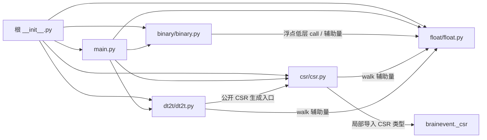

# JIT Uniform 文件组织与迁移计划

更新日期：2026-10-26。状态：文件迁移及 CPU、导出/注册、类型、安装包验证已完成；GPU 执行未验证。

采用与 CSR、Dense、FCN 一致的组织方式：**根目录保留对象层，完整计算文件按功能归组，
测试进入对应的 `test/`，开发文档放在 `dev/`。** 三个 JIT 包统一使用
`binary/`、`float/`、`csr/`、`dt2t/` 四个功能目录，各自保留权重分布实现。

相关方案：[CSR 功能目录](../../_csr/dev/docs/specs/2026-10-25-csr-layout.md)、
[CSR 测试目录](../../_csr/dev/docs/specs/2026-10-25-csr-test-layout.md)、
[Dense](../../_dense/dev/dense-structure-plan.md)、
[FCN](../../_fcn/dev/fcn-structure-plan.md)；同批迁移：[Normal 计划](../../_jit_normal/dev/jit-normal-structure-plan.md)、[Scalar 计划](../../_jit_scalar/dev/jit-scalar-structure-plan.md)。

## 1. 范围、现状与统一规则

迁移前共有 **19 个 Python/CUDA 文件**：6 个生产或包入口 Python 文件、1 个测试辅助文件、
5 个测试文件、7 个 CUDA 文件。本次已移动其中 **16 个文件**，新增 **9 个包初始化文件**。
文档不计入源码迁移数量。三包合计移动 48 个文件、新增 27 个初始化文件，保留 21 个 CUDA 源文件的内容。

| 层级 | 主要职责 | 本包入口 |
| --- | --- | --- |
| 对象与导出层 | 对象元数据、初始化、单位、pytree、运算路由和结构转换 | `JITCUniformR`、`JITCUniformC`，保留在 `main.py` |
| binary | 事件 MV/MM、后端分发、求导与 batching | `binary_jitumv`、`binary_jitumm` |
| float | 稠密矩阵生成及普通数值 MV/MM | `jitu`、`jitumv`、`jitumm` |
| csr | 随机连接的两阶段 count/fill 与规范 CSR 生成 | `jitu_to_csr` |
| dt2t | 按 CSR 非零元素顺序计算逐突触结果 | `jitumv_dt2t` |
| 测试辅助与开发文档 | 分布参考实现、迁移规格及验收记录 | 根 `_test_util.py`、`dev/` |

统一规则：

- 以完整文件为迁移单位；MV/MM、随机生成、AD、batching 和后端注册继续随原功能实现移动。
- CUDA 与调用它的 Python 实现同目录；保留文件名及 `Path(__file__).parent` 定位方式。
- 功能包的 `__init__.py` 直接转导出现有对象，不新增计算包装，也不重复构造 primitive。
- 五个测试目录都添加 `__init__.py`，保留 `*_test.py` 命名，避免跨包同名测试模块冲突。
- `main.py`、根 `__init__.py`、`_test_util.py` 留在根目录；`dev/` 不添加初始化文件。
- 保留本包 `w_low`、`w_high` 参数及其随机生成过程；共享的 `_misc`、`_data`、`_numba_random`、
  `_op` 继续使用现有位置，不在本次引入新的 JIT 公共计算层。

这里的 `csr/` 是本分布的生成与物化功能；返回的 CSR 对象仍来自 `brainevent._csr`。
`float.py` 的稠密生成和 MV/MM 保持在同一文件，本次不另拆生成器或 RNG 目录。

## 2. 迁移后目录

以下为当前目录；保留原有分布对比文档，并更新其中指向已迁移源码的链接：

```text
brainevent/_jit_uniform/
├── __init__.py
├── main.py
├── _test_util.py
├── test/
│   ├── __init__.py
│   └── main_test.py
├── binary/
│   ├── __init__.py
│   ├── binary.py
│   ├── binary_jitumv.cu
│   ├── binary_jitumm.cu
│   └── test/
│       ├── __init__.py
│       └── binary_test.py
├── float/
│   ├── __init__.py
│   ├── float.py
│   ├── float_jitu.cu
│   ├── float_jitumv.cu
│   ├── float_jitumm.cu
│   └── test/
│       ├── __init__.py
│       └── float_test.py
├── csr/
│   ├── __init__.py
│   ├── csr.py
│   ├── csr.cu
│   └── test/
│       ├── __init__.py
│       └── csr_test.py
├── dt2t/
│   ├── __init__.py
│   ├── dt2t.py
│   ├── dt2t.cu
│   └── test/
│       ├── __init__.py
│       └── dt2t_test.py
└── dev/
    ├── jit-uniform-structure-plan.md
    └── jit-0.3-vs-mmop.md
```

## 3. 文件迁移清单

路径相对于 `brainevent/_jit_uniform/`；本表覆盖迁移前全部 19 个 Python/CUDA 文件。

| 迁移前路径 | 当前路径 |
| --- | --- |
| `__init__.py` | `__init__.py`，保留根导出 |
| `_test_util.py` | `_test_util.py`，保留参考实现与路径 |
| `binary.py` | `binary/binary.py` |
| `binary_jitumm.cu` | `binary/binary_jitumm.cu` |
| `binary_jitumv.cu` | `binary/binary_jitumv.cu` |
| `binary_test.py` | `binary/test/binary_test.py` |
| `csr.cu` | `csr/csr.cu` |
| `csr.py` | `csr/csr.py` |
| `csr_test.py` | `csr/test/csr_test.py` |
| `dt2t.cu` | `dt2t/dt2t.cu` |
| `dt2t.py` | `dt2t/dt2t.py` |
| `dt2t_test.py` | `dt2t/test/dt2t_test.py` |
| `float.py` | `float/float.py` |
| `float_jitu.cu` | `float/float_jitu.cu` |
| `float_jitumm.cu` | `float/float_jitumm.cu` |
| `float_jitumv.cu` | `float/float_jitumv.cu` |
| `float_test.py` | `float/test/float_test.py` |
| `main.py` | `main.py`，保持对象定义和功能包入口 |
| `main_test.py` | `test/main_test.py` |

本次新增初始化文件共 9 个：

- `binary/__init__.py`、`float/__init__.py`、`csr/__init__.py`、`dt2t/__init__.py`。
- `test/__init__.py`、`binary/test/__init__.py`、`float/test/__init__.py`、
  `csr/test/__init__.py`、`dt2t/test/__init__.py`。

已将 [AGENTS.md](../../../AGENTS.md) 第 11 条的功能内 `test/` 规则扩展到三个 JIT 包，
其他规则保持原样。本计划及实施记录继续存放于本包 `dev/`。

## 4. 导入、导出与行为约束

### 4.1 依赖方向及导入调整



图中省略功能包转导出节点及通用工具。保持现有依赖方向，功能实现不反向导入本包根入口，
避免对象初始化时形成循环依赖。

| 引用位置 | 迁移后的处理 |
| --- | --- |
| 根 `__init__.py`、`main.py` | 原 `.binary`、`.float`、`.csr`、`.dt2t` 由同名功能包提供，保留名称和对象身份 |
| `binary/binary.py` | 浮点低层 `jitumv_p_call`、`jitumm_p_call` 改从 `..float.float` 导入 |
| `csr/csr.py` | `_LANE_STRIDE`、`_chunk_size`、`_walk_length` 改从 `..float.float` 导入 |
| `dt2t/dt2t.py` | `jitu_to_csr` 改从 `..csr` 导入，三个 walk 辅助量改从 `..float.float` 导入 |
| 测试中的公开函数导入 | 原功能模块路径由同名功能包承接；根 `main`、`_test_util` 路径不变 |
| 私有成员或模块属性替换 | 指向 `brainevent._jit_uniform.<功能>.<实现模块>`，避免替换转导出包后不影响函数全局变量 |

`binary.py` 还从 `float.py` 获取 `_chunk_size`、`_walk_length`、`_LANE_STRIDE`；这三个名称和两个低层 call 一并改从 `..float.float` 引用。

### 4.2 根导出与功能包导出

本包根 `__all__` 的 **15 个名称**及顺序保持不变：

| 来源 | 根包保留名称 |
| --- | --- |
| 对象层 | `JITCUniformR`、`JITCUniformC` |
| binary | `binary_jitumv`、`binary_jitumv_p`、`binary_jitumm`、`binary_jitumm_p` |
| float | `jitu`、`jitu_p`、`jitumv`、`jitumv_p`、`jitumm`、`jitumm_p` |
| csr | `jitu_to_csr`、`jitu_csr_count_p` |
| dt2t | `jitumv_dt2t` |

根包只导出 `JITCUniformR`、`JITCUniformC`；`JITCUniformMatrix` 继续留在 `main.py`，保持现有导出范围。上下界参数的顺序、单位检查、梯度和随机采样过程均按现有实现保留。

分别对比本包和 `brainevent` 顶层的原有导出面；例如 `jitu_to_csr` 和
`jitu_csr_count_p` 目前属于本包根导出，不能据此把它们新增到顶层公共 API。

功能包按原模块 `__all__` 保持星号导出范围，同时显式保留已有低层调用入口：

| 功能包 | 保留方式 |
| --- | --- |
| `binary/` | 原有两个函数、两个 primitive；额外提供 `binary_jitumv_p_call`、`binary_jitumm_p_call` 显式属性 |
| `float/` | 原有生成/MV/MM 三个函数及三个 primitive；额外提供 `jitu_p_call`、`jitumv_p_call`、`jitumm_p_call` 显式属性 |
| `csr/` | 原 `__all__` 的五个名称全部转导出，包括 count/fill primitive 及对应低层 call |
| `dt2t/` | 原 `__all__` 的公开函数、fill primitive、低层 call 三个名称全部转导出 |

私有 helper 从实际实现模块引用；不把导入的所有工具函数自动暴露在功能包上。
不创建旧实现模块别名或兼容转发文件；原 `.binary` 等路径转为包入口，新的实际实现路径
为 `.binary.binary` 等。

### 4.3 primitive 与后端注册

本包共 8 个 primitive，实际注册名如下，不能由新文件路径或函数名重新推导：

| 实现位置 | Python 名称 | 注册名 |
| --- | --- | --- |
| `binary/binary.py` | `binary_jitumv_p` | `binary_jitumv` |
| `binary/binary.py` | `binary_jitumm_p` | `binary_jitumm` |
| `csr/csr.py` | `jitu_csr_count_p` | `jitu_csr_count` |
| `csr/csr.py` | `jitu_csr_fill_p` | `jitu_csr_fill` |
| `dt2t/dt2t.py` | `jitumv_dt2t_p` | `jitumv_dt2t_fill` |
| `float/float.py` | `jitu_p` | `float_jitu` |
| `float/float.py` | `jitumv_p` | `float_jitumv` |
| `float/float.py` | `jitumm_p` | `float_jitumm` |

现有 CPU 后端为 `numba`，GPU 后端为 `cuda_raw`；这些 primitive 没有 `jax_raw`。
保持后端顺序、默认选择、tags、JVP/VJP、batching 和已有 benchmark 注册。
部分旧 docstring 仍提及 Pallas 或只提 CUDA，验收以实际注册为准。

### 4.4 随机连接与逐突触语义

- 保持 seed 初始化、连接长度、lane/chunk/walk 规则及本分布采样算法，固定输入须复现迁移前结果。
- 保持 `corder`、`transpose`、R/C 对象方向，以及稠密生成、MV/MM、CSR 之间已有的一致性。
- CSR 继续通过 count/fill 两阶段生成；保留读取 nnz、索引类型检查、空结构处理、规范列排序，
  以及对 `brainevent._csr.CSR` 的局部导入。此次不改变动态 nnz 对 JIT 的既有限制。
- 当前 `jitumv_dt2t` 在两种 `corder` 下都调用 `jitu_to_csr`，
  按规范 CSR 非零元素顺序乘以 `y[row]` 或 `y[col]`。
  独立 fill primitive 和 `dt2t.cu` 仍被低层测试使用，须完整保留。
- `dt2t.py` 顶部关于 fused 路径的描述与当前公共入口存在差异；以实际调用链作为迁移依据，
  不借此改接算法或删除内核。

## 5. CUDA 资源与安装包

7 个 CUDA 文件对应 8 个 loader 调用位置，其中 `csr.cu` 由 count/fill 各加载一次：

| 迁移后资源路径 | 编译模块名 | loader 数量 |
| --- | --- | --- |
| `binary/binary_jitumv.cu` | `jit_uniform_binary_jitumv` | 1 |
| `binary/binary_jitumm.cu` | `jit_uniform_binary_jitumm` | 1 |
| `csr/csr.cu` | `jit_uniform_csr` | 2（count / fill） |
| `dt2t/dt2t.cu` | `jit_uniform_dt2t` | 1 |
| `float/float_jitu.cu` | `jit_uniform_jitu` | 1 |
| `float/float_jitumv.cu` | `jit_uniform_jitumv` | 1 |
| `float/float_jitumm.cu` | `jit_uniform_jitumm` | 1 |

迁移须保持所有 CUDA 文件字节一致、loader 文件名和编译模块名不变。沿用
`pyproject.toml` 的包发现和 `*.cu` / `*.h` package data 配置，实际构建 wheel 后，
在源码目录外安装并检查全部 8 处 loader 的资源路径及公共头文件可用性。
CPU 下可检查路径、参数和资源内容；CUDA 编译与执行需要另在 GPU 上验证。

## 6. 测试迁移与验收

### 6.1 现有测试清单

| 迁移前文件 | 当前位置 | 静态 `test_*` 定义数 |
| --- | --- | --- |
| `binary_test.py` | `binary/test/binary_test.py` | 20 |
| `csr_test.py` | `csr/test/csr_test.py` | 9 |
| `dt2t_test.py` | `dt2t/test/dt2t_test.py` | 13 |
| `float_test.py` | `float/test/float_test.py` | 26 |
| `main_test.py` | `test/main_test.py` | 46 |

合计 **114 个测试函数或方法定义**。这是源码静态计数，不是参数化用例数；
相同环境下迁移前后均收集 **965 个参数化用例**，路径映射后节点集完全一致。
已执行包含 slow/Numba 的全部五份测试，结果见第 8 节。

本包重点：

- 保留事件 MV/MM 对 `w_low`、`w_high` 的梯度与有限差分对照，不能只检查前向数值。
- 重点回归固定 seed 下稠密、MV/MM、CSR 的一致性，以及 `corder=False` 的 dt2t 重复调用顺序。
- 保留 `dense_uniform_reference` 及其独立参考随机生成过程，不把目录统一扩展成分布实现合并。

三包共同需要覆盖：R/C 对象、左右 MV/MM、二值/带权事件、JIT/vmap/AD、dtype 和单位、
固定 seed、空形状/零概率/零非零元素、两种 `corder` 和转置、CSR 与 dt2t 的结构顺序。
按现有接口支持范围和迁移前结果验收，不在结构调整中扩展功能契约。

### 6.2 验收清单

| 检查项 | 通过标准 |
| --- | --- |
| 文件映射 | 19 个原文件各有唯一去向；16 次移动、9 个初始化文件；无遗漏或重复实现 |
| 源码保持 | 7 个 CUDA 文件哈希不变；Python 计算 AST 仅允许导入及必要路径引用调整 |
| 测试收集 | 使用 `--collect-only -m ''`；映射路径后节点集与基线一致，无同名模块冲突 |
| CPU 执行 | 显式包含 slow/Numba 的全部五份测试；保留现有 skip 条件，记录通过、失败、跳过及筛除数量 |
| GPU 执行 | 运行可用的 `cuda_raw` 用例，验证编译、数值、AD/batching 和实际资源加载；无 GPU 则明确记录未验证 |
| 导出与注册 | 根包、功能包、实际实现对象身份一致，根导出及 8 个 primitive 的注册与基线一致 |
| 跨包合同 | 验证 `brainevent._data_test` 的 JITC 转换与对象合同，以及相关 registry/共享随机工具用例 |
| 安装包 | wheel 构建与源码目录外安装成功，功能包可导入，7 个 CUDA 资源及其 8 处 loader 路径正确 |
| 类型检查 | 按项目配置运行 `mypy --no-site-packages`；记录已有问题，迁移不新增错误 |
| 联合检查 | 三个 JIT 包共同收集与导入；与已迁移的 CSR/Dense/FCN 同名测试包共同收集无冲突 |

必须显式导入 `brainevent._jit_uniform.csr` 的 `jitu_csr_count_p` 并核对 CPU 后端，
不能只依赖 `_data_test.py` 的通过/跳过结果：其中 `_csr_count_backends` 会捕获导入异常，
错误的功能包导出可能使转换测试静默跳过。

建议在项目根目录、已安装依赖的环境中执行以下命令；迁移前后各记录一次收集结果，
两份结果按第 3 节路径映射比较：

```bash
JAX_PLATFORMS=cpu python -m pytest --collect-only -q -m "" brainevent/_jit_uniform
JAX_PLATFORMS=cpu python -m pytest -q -m "" brainevent/_jit_uniform
python -m mypy --no-site-packages
```

默认 `pytest` 带有 `-m 'not slow'`，会筛掉主要 Numba 变体及标为 slow 的整组测试；
默认快速测试不能作为本次迁移的完整 CPU 验收。GPU、跨包和安装包检查另按表执行。
如发现失败，先用迁移前快照复现并区分已有问题与迁移回归，再决定后续修复范围。

## 7. 实施顺序与完成记录

本次按 **Normal → Uniform → Scalar** 逐包迁移并核对导出、注册及资源。三包归位后，
按包及功能测试文件使用独立进程执行 CPU 回归，再完成跨包、类型和安装包检查。

1. **记录基线。** 在当前工作分支保存本包源码、7 个 CUDA 哈希、导出面、8 个 primitive
   注册及完整测试收集结果；保留工作区中已有的 CSR/Dense/FCN 和其他改动。
2. **按清单归位。** 移动 16 个完整文件，新增 9 个初始化文件；按第 4 节调整导入，
   原测试参数化、skip 条件和参考实现保持原样。
3. **检查边界。** 核对低层 call、根导出、私有 helper、三包相互独立导入和 CUDA 路径；
   一并更新 AGENTS 第 11 条及受影响的有效示例路径。
4. **执行验收。** 先检查收集，再执行 CPU/可用 GPU 回归；三包完成后构建、安装 wheel，
   检查跨包合同并运行类型检查。
5. **回填结果。** 在本文记录实际改动、环境、用例数量、失败归因及未验证项；
   仅当对应检查完成后将状态改为已完成。

实施结果：

| 阶段 | 结果 |
| --- | --- |
| 文件迁移 | 完成 16 次移动、9 个初始化文件；仅三个实现文件各自的相对导入发生变化 |
| 收集与 CPU 回归 | 节点集不变；931 passed、34 skipped，0 failed、0 deselected |
| GPU 回归 | 当前 JAX 环境只提供 CPU 设备；实际 CUDA 编译/执行未验证 |
| 导出、跨包与注册 | 本包及顶层导出范围、primitive 注册、内部引用对象身份与基线一致 |
| 类型与 wheel | mypy 通过；wheel 构建、安装、资源和转换冒烟检查通过 |
| 差异与已有问题 | 无迁移回归；联合收集发现并复现一项已有 CSR 开发实验导入问题，见第 8 节 |

## 8. 实测结果与验证范围

### 8.1 环境与源码对照

验证环境：Python 3.12.13、JAX/JAXLIB 0.12.0.1、Numba 0.68.0、pytest 9.1.1、
brainunit/brainstate 0.6.0、mypy 2.4.0；`JAX_PLATFORMS=cpu`，默认未开启 JAX x64。
测试按功能文件分进程运行，显式传入 `-m ""`，未使用默认的 `not slow` 筛选。

对照迁移前快照，本包 7 个 CUDA 文件、5 个测试文件、`float.py`、根
`main.py`、`__init__.py`、`_test_util.py` 内容逐字节一致。
仅 `binary.py`、`csr.py`、`dt2t.py` 的 4 行相对导入改变；排除这些导入后计算 AST 一致。
`jit-0.3-vs-mmop.md` 只更新 5 处源码链接，比较结论保留原样。

### 8.2 本包 CPU 回归

| 功能 | passed | skipped |
| --- | ---: | ---: |
| binary | 346 | 0 |
| float | 121 | 24 |
| csr | 17 | 0 |
| dt2t | 17 | 10 |
| main | 430 | 0 |
| 合计 | 931 | 34 |

跳过原因按 pytest 实际报告记录：

- 32 项：`No GPU detected via jax.devices('gpu')`。
- 2 项：`JAX x64 is disabled.`。

### 8.3 三包联合与安装验证

- 三包原有 2,974 个用例完整保留；联合执行合计 **2,880 passed、94 skipped**，
  无失败、无筛除。测试涉及固定 seed、事件掩码、非活跃 NaN/Inf 隔离、JVP/VJP、
  vmap、R/C 对象、CSR 转换及 dt2t 顺序，全部使用原有断言。
- `_data_test.py`、`_registry_test.py`、`_numba_random_test.py`、
  `_misc_test.py` 合计 **385 passed**；registry 覆写测试产生一条预期警告。
- 三包总计 46 个根导出及函数签名、24 个 primitive 的注册/后端/default/tags 检查通过；
  功能包与实现模块直接引用同一对象，CSR count 入口可显式导入，未由异常捕获掩盖失败。
- mypy 迁移前检查 130 个源文件、迁移后检查 157 个源文件，均无错误；
  新增数量对应 27 个初始化文件。
- wheel 构建成功，在源码目录外安装后复查导出、注册及资源；57 个原有 Python/CUDA
  文件均位于正确路径，27 个新增初始化文件和公共 CUDA 头文件齐全，无已移动旧路径残留。
- 已校验 21 个 CUDA 文件的内容及 24 处 loader 路径表达式，安装后的 6 个 JITC
  转换用例全部通过。资源检查未执行 CUDA 编译，不能替代 GPU 回归。

六个运行时包（CSR、Dense、FCN 与三个 JIT 包）联合收集 **7,368 项**，无模块名冲突。
该检查使用 `--ignore=brainevent/_csr/dev`：未经排除的首次收集会在
`_csr/dev/delay_mv/test/delay_main_test.py` 导入不存在的
`brainevent._tcsr.delay_mv` 时失败。相同失败已在迁移前源码快照中复现，
属于已有开发实验问题，本次未改动该实验代码。

审计目录：`/tmp/brainevent-jit-layout-d8edr2_w`。其中保存迁移前快照、文件映射、收集日志、逐功能 pytest 日志及
JUnit 报告、导出/注册快照、mypy 日志和 wheel 安装检查结果。
