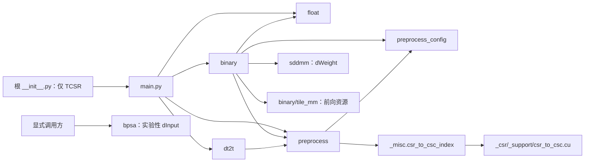

# TCSR 文件归属与迁移计划

更新日期：2026-10-26。状态：目录迁移、CPU 回归、全类型检查及 dev 隔离审计已完成。
GPU 实际执行尚未验证；扩展 x64 检查发现的既有问题见
[迁移审计报告](tcsr-migration-audit.md)。

本方案先确定 `tile_mm`、`sddmm`、`bpsa` 的职责，再组织其余文件。
沿用 CSR、Dense、FCN、JIT 的标准：根目录保留对象层，完整计算文件按功能归组，
测试进入对应 `test/`，开发资料进入 `dev/`。

参考：[CSR](../../_csr/dev/csr-structure-plan.md)、
[FCN](../../_fcn/dev/fcn-structure-plan.md)、
[JIT](../../_jit_normal/dev/jit-normal-structure-plan.md)。

## 1. 三个现有子目录的归属结论

| 迁移前目录 | 实际职责与数据契约 | 归属结论 | 实施路径 |
| --- | --- | --- | --- |
| `tile_mm/` | TCSR 事件 MM 前向计算的私有 CUDA 源码及本地头文件 | 归属 `binary`；随事件乘法实现移动 | `binary/tile_mm/` |
| `sddmm/` | 基于 TCSR 连接槽位的权重梯度 dWeight，包含 MV/MM、binary/float 四个服务 | 保留为 TCSR 独立正式功能包；由 `binary` 的反向规则调用 | `sddmm/`，测试移至 `sddmm/test/` |
| `bpsa/` | 使用 TCSR tile 元数据计算受事件掩码约束的输入梯度 dInput | 保留为需显式导入的 TCSR 实验扩展包；不进入稳定对象的默认导入链 | `bpsa/`，测试移至 `bpsa/test/` |

三个目录都与 TCSR 的数据布局直接相关，但职责层级不同。此次不将它们迁入普通
`_csr`，也不把三者合并为同一个计算包。

### 1.1 tile_mm：binary 的前向内核资源

证据：[资源包说明](../binary/tile_mm/__init__.py)、
[二值运算实现](../binary/binary.py)、
[内核 ABI](../binary/tile_mm/binary_csrmm_tile.cu)。

- `tile_mm/__init__.py` 仅说明资源用途，没有 Python 算子入口。
- `binary.py` 的两个 loader 调用位置加载 `binary_csrmm_tile.cu`：
  直接 tile MM 路径，以及 mirror/indexed 调度中的同质权重分支。
- ABI 使用 `local_targets:uint16`、`tile_offsets:int32`、`indptr:int64`，
  输入事件按 BN 布局转换为 int8 活动掩码；这不是可直接套用普通 CSR 的资源。
- 加载时传入本地 `extra_include_paths`，源码依次包含 `bn_tile.cuh`、
  `bn_tile_kernels.cuh`，三者必须整体移动。
- 普通 weighted MM 有独立 hybrid 路由，已有测试要求它不误走 tile 路径；
  文件归组不改变这项分发规则。

将整个资源包嵌套到 `binary/tile_mm/` 后，`binary.py` 自身也进入 `binary/`，
原 `Path(__file__).parent / "tile_mm"` 可以保持成立。
保留资源包的 `__init__.py` 以便包发现，不新增独立 Python 运算包装或额外测试包；
其行为继续由 `binary/test/binary_test.py` 覆盖。

### 1.2 sddmm：独立的 TCSR 权重梯度功能

证据：[正式导出](../sddmm/__init__.py)、
[实现](../sddmm/sddmm.py)、
[归属合同测试](../sddmm/test/sddmm_test.py)。

保留四个入口：

- `tcsr_sddmm_dweight_binary`、`tcsr_sddmm_dweight_float`。
- `tcsr_sddmv_dweight_binary`、`tcsr_sddmv_dweight_float`。

这些函数按连接槽位产生梯度；MM 对 batch 维归约，MV 处理单个向量。
binary 服务按事件活动性计算，float 服务保留输入值，用于 weighted/pp_prop 等路径。
它们需要完整索引及 TCSR 的 tile 元数据，并约束方向、batch、dtype 和 FFI 布局。

当前调用方是 `binary.py` 的梯度规则。现有测试明确要求正式入口由
`sddmm` 包持有，`binary` 引用同一实现对象且不把它们加入自身 `__all__`。
因此保留独立功能边界，避免将反向服务散入前向源码。

它与 [通用 _sddmm.py](../../_sddmm.py) 的接口不同：后者接受稠密矩阵及 COO/BCOO
采样索引并返回 BCOO，不依赖 TCSR 元数据。此次不合并这两套接口。
它也不同于 `dt2t` 的逐连接乘法，不因二者都返回槽位数组而合并目录。

### 1.3 bpsa：显式导入的 TCSR 实验性输入梯度扩展

证据：[实验包说明](../bpsa/__init__.py)、
[数据契约](../bpsa/bpsa.py)、
[显式导入测试](../bpsa/test/bpsa_test.py)、
[稳定对象导入隔离测试](../test/main_test.py)。

- `pack_event_mask_bn` 使用纯 JAX 生成 little-endian uint8 事件掩码。
- `csr_bpsa_dinput_masked`、`csr_bpsa_dinput_single` 是 GPU 输入梯度服务，
  消费 TCSR 槽位顺序的权重、uint16 local targets、按 8192 列分块的 tile offsets；
  完整 CSR column indices 不在其 FFI 参数中。
- 当前稳定 `main.py`、`binary.py` 没有调用或导入 BPSA；
  fresh-process 测试明确要求导入稳定 TCSR 不加载 `brainevent._tcsr.bpsa`。
- 另一组测试明确保留 `from brainevent._tcsr import bpsa` 的显式使用方式。
  当前 `backward_algorithm` 只支持 `bptt`、`pp_prop`，不恢复已移除的
  `binary_grad_mode="bpsa"`。

**本次保留 `bpsa/` 作为独立实验扩展，保持既有显式入口。**
不因函数名带 `csr_` 就将其移入普通 CSR，也不将它归档到会被安装包排除的 `dev/`。
后续若要停用或移除 BPSA，应单独处理其显式 API 与测试，不混入此次目录迁移。

## 2. 其余文件的功能划分

迁移前共 **36 个源码或资源文件**：20 个 Python、14 个 CUDA、2 个 CUDA 头文件。
七份测试包含 **149 个静态 test_* 定义**。本计划覆盖全部文件，不删除实现。

| 层级 | 内容及归属 |
| --- | --- |
| 根对象层 | `main.py` 中的 `TCSR`、`TiledCompressedSparseData`；根 `__init__.py` 仅公开 `TCSR` |
| `binary/` | 事件 MV/MM、后端分发、AD/batching、三个 hybrid CUDA 文件及 `tile_mm/` |
| `float/` | 普通数值 MV/MM、AD/batching、两个 CUDA 文件 |
| `dt2t/` | 逐连接 MV/MM 乘法、转置镜像处理及共用的 `dt2t.cu` |
| `preprocess/` | TCSR 结构、TCSC 镜像、共享 buffers/workspace；同目录保留 `preprocess_config.py` |
| `sddmm/` | 正式的 TCSR 采样权重梯度服务及四个 CUDA 文件 |
| `bpsa/` | 显式实验性输入梯度服务、掩码打包及两个 CUDA 文件 |
| `dev/` | 迁移文档、无运行时调用方的资源监控工具、未使用的重复 CUDA 源码 |

`preprocess_config.py` 同时提供编译宏、workspace 容量计算、配置缓存和手动 benchmark。
它被 `preprocess.py`、`binary.py` 正式调用，属于运行时支持，不能因为其中含有
benchmark 就将整份文件放进 `dev/`。本次保持完整文件，不另拆调参框架。

两个开发资料归档项的依据：

- `resource_monitor.py` 用于独立 benchmark worker 的 RAM/VRAM 采样；
  当前 be0.3 源码中未找到调用方，不属于对象或计算路径。移动至
  `dev/tools/resource_monitor.py`，保留完整工具。
- 本地 `csr_to_csc.cu` 与 `_csr/_support/csr_to_csc.cu` 字节一致。
  `preprocess.build_tcsc_mirror` 实际调用公共 `_misc.csr_to_csc_index`，
  后者已加载 CSR 的 `_support` 资源。移动重复文件至 `dev/legacy/csr_to_csc.cu`
  留档，不给 TCSR 新增第二条转换加载链。

保留 `main.py` 中的 canonical storage、逻辑转置视图、惰性镜像、单位、pytree、
索引/切片/转换、求和及运算路由；不按对象方法再拆出额外目录。

## 3. 实施后的目录

```text
brainevent/_tcsr/
├── __init__.py
├── main.py
├── test/
│   ├── __init__.py
│   └── main_test.py
├── binary/
│   ├── __init__.py
│   ├── binary.py
│   ├── binary_csrmv_hybrid.cu
│   ├── binary_indexed_csrmv_hybrid.cu
│   ├── binary_indexed_csrmm_hybrid.cu
│   ├── tile_mm/
│   │   ├── __init__.py
│   │   ├── binary_csrmm_tile.cu
│   │   ├── bn_tile.cuh
│   │   └── bn_tile_kernels.cuh
│   └── test/
│       ├── __init__.py
│       └── binary_test.py
├── float/
│   ├── __init__.py
│   ├── float.py
│   ├── float_csrmv.cu
│   ├── float_csrmm.cu
│   └── test/
│       ├── __init__.py
│       └── float_test.py
├── dt2t/
│   ├── __init__.py
│   ├── dt2t.py
│   ├── dt2t.cu
│   └── test/
│       ├── __init__.py
│       └── dt2t_test.py
├── preprocess/
│   ├── __init__.py
│   ├── preprocess.py
│   ├── preprocess_config.py
│   └── test/
│       ├── __init__.py
│       └── preprocess_test.py
├── sddmm/
│   ├── __init__.py
│   ├── sddmm.py
│   ├── sddmm_binary.cu
│   ├── sddmm_float.cu
│   ├── sddmv_binary.cu
│   ├── sddmv_float.cu
│   └── test/
│       ├── __init__.py
│       └── sddmm_test.py
├── bpsa/
│   ├── __init__.py
│   ├── bpsa.py
│   ├── bpsa_mm.cu
│   ├── bpsa_mv.cu
│   └── test/
│       ├── __init__.py
│       └── bpsa_test.py
└── dev/
    ├── tcsr-structure-plan.md
    ├── tcsr-migration-audit.md
    ├── tools/
    │   └── resource_monitor.py
    └── legacy/
        └── csr_to_csc.cu
```

## 4. 逐文件迁移清单

路径相对于 `brainevent/_tcsr/`。合计 **24 个文件移动、12 个原位保留**；
新增 **11 个初始化文件**，文档不计入源码移动数量。

| 迁移前路径 | 实施后的路径 |
| --- | --- |
| `__init__.py` | `__init__.py`（保留） |
| `binary.py` | `binary/binary.py` |
| `binary_csrmv_hybrid.cu` | `binary/binary_csrmv_hybrid.cu` |
| `binary_indexed_csrmm_hybrid.cu` | `binary/binary_indexed_csrmm_hybrid.cu` |
| `binary_indexed_csrmv_hybrid.cu` | `binary/binary_indexed_csrmv_hybrid.cu` |
| `binary_test.py` | `binary/test/binary_test.py` |
| `bpsa/__init__.py` | `bpsa/__init__.py`（保留） |
| `bpsa/bpsa.py` | `bpsa/bpsa.py`（保留） |
| `bpsa/bpsa_mm.cu` | `bpsa/bpsa_mm.cu`（保留） |
| `bpsa/bpsa_mv.cu` | `bpsa/bpsa_mv.cu`（保留） |
| `bpsa/bpsa_test.py` | `bpsa/test/bpsa_test.py` |
| `csr_to_csc.cu` | `dev/legacy/csr_to_csc.cu` |
| `dt2t.cu` | `dt2t/dt2t.cu` |
| `dt2t.py` | `dt2t/dt2t.py` |
| `dt2t_test.py` | `dt2t/test/dt2t_test.py` |
| `float.py` | `float/float.py` |
| `float_csrmm.cu` | `float/float_csrmm.cu` |
| `float_csrmv.cu` | `float/float_csrmv.cu` |
| `float_test.py` | `float/test/float_test.py` |
| `main.py` | `main.py`（保留） |
| `main_test.py` | `test/main_test.py` |
| `preprocess.py` | `preprocess/preprocess.py` |
| `preprocess_config.py` | `preprocess/preprocess_config.py` |
| `preprocess_test.py` | `preprocess/test/preprocess_test.py` |
| `resource_monitor.py` | `dev/tools/resource_monitor.py` |
| `sddmm/__init__.py` | `sddmm/__init__.py`（保留） |
| `sddmm/sddmm.py` | `sddmm/sddmm.py`（保留） |
| `sddmm/sddmm_binary.cu` | `sddmm/sddmm_binary.cu`（保留） |
| `sddmm/sddmm_float.cu` | `sddmm/sddmm_float.cu`（保留） |
| `sddmm/sddmm_test.py` | `sddmm/test/sddmm_test.py` |
| `sddmm/sddmv_binary.cu` | `sddmm/sddmv_binary.cu`（保留） |
| `sddmm/sddmv_float.cu` | `sddmm/sddmv_float.cu`（保留） |
| `tile_mm/__init__.py` | `binary/tile_mm/__init__.py` |
| `tile_mm/binary_csrmm_tile.cu` | `binary/tile_mm/binary_csrmm_tile.cu` |
| `tile_mm/bn_tile.cuh` | `binary/tile_mm/bn_tile.cuh` |
| `tile_mm/bn_tile_kernels.cuh` | `binary/tile_mm/bn_tile_kernels.cuh` |

新增初始化文件：

- 四个功能包：`binary/__init__.py`、`float/__init__.py`、
  `dt2t/__init__.py`、`preprocess/__init__.py`。
- 七个测试包：`test/__init__.py`、`binary/test/__init__.py`、
  `float/test/__init__.py`、`dt2t/test/__init__.py`、
  `preprocess/test/__init__.py`、`sddmm/test/__init__.py`、`bpsa/test/__init__.py`。

`tile_mm` 的原初始化文件随目录移动；`sddmm`、`bpsa` 的现有初始化文件保留。
`dev/` 及其子目录不添加初始化文件。[AGENTS.md](../../../AGENTS.md)
第 11 条已将功能内测试目录规则扩展到 `_tcsr`，继续使用 `*_test.py` 命名。

## 5. 导出、依赖及测试调整

### 5.1 调用方向



图中省略包转导出及通用工具。BPSA 与稳定对象导入链保持隔离。

### 5.2 导出约束

- `brainevent.TCSR` 与 `brainevent._tcsr.TCSR` 继续指向同一个类，
  保留 `TCSR.__module__ = "brainevent"`。
  `TiledCompressedSparseData` 仍留在 `main.py`，不扩大根 `__all__`。
- 新功能包直接引用实际实现对象，不新增包装函数或重复注册 primitive。
- `binary/__all__` 保留 `BINARY_BACKENDS`、两个乘法函数和两个 primitive；
  两个 `binary_*_p_call` 继续可显式导入。
- `float/__all__` 保留两个乘法函数、两个 primitive；
  `csrmv_p_call`、`csrmm_p_call` 继续可显式导入。
- `dt2t` 保留原六个导出，`preprocess` 保留原十一个导出；
  `preprocess_config` 的十三个入口继续由新实现模块提供。
- `sddmm` 四个正式入口与 `bpsa` 三个实验入口保持原路径；
  不在根包自动导入 BPSA，不恢复已移除的实验梯度模式。
- 私有 helper 不批量加入功能包公开面。旧
  `brainevent._tcsr.preprocess_config` 改用
  `brainevent._tcsr.preprocess.preprocess_config`；
  旧资源目录 `_tcsr.tile_mm` 改为 `_tcsr.binary.tile_mm`。
  与前面的迁移一致，不增加旧实现模块别名。

### 5.3 生产代码导入调整

| 位置 | 调整要求 |
| --- | --- |
| `main.py` | `_validate_backward_algorithm` 改从 `.binary.binary` 引用 |
| `main.py` 的局部公开分发 | 保留 `from . import binary`、`from . import float as float_ops`，经功能包调用公开入口 |
| `main.py` 的 dt2t | 公开入口仍从 `.dt2t` 引用；`_csrmv_dt2t_prepared` 改从 `.dt2t.dt2t` 引用 |
| `binary/binary.py` | `.float`、`.preprocess`、`.sddmm` 改为上一级相应功能包 |
| `binary/binary.py` 的配置 | `.preprocess_config` 改为 `..preprocess.preprocess_config` |
| `dt2t/dt2t.py` | `.preprocess` 改为 `..preprocess` |
| `preprocess/preprocess.py` | `.preprocess_config` 仍指向同目录文件；公共 CSR 转换依赖不变 |
| `preprocess/preprocess_config.py` | `_CUDA_SOURCE` 改为 `Path(__file__).parent.parent / "binary" / "binary_csrmv_hybrid.cu"` |

保留现有懒导入、FFI 模块名、缓存字段、后端默认值和编译宏，不引入反向包依赖。

### 5.4 测试导入与 monkeypatch

这里必须区分“替换对象层调用的公开入口”与“替换实现模块的全局变量”：

| 测试 | 调整要求 |
| --- | --- |
| `binary_test.py` | 使用私有 kernel、梯度规则或 patch loader 的 `binary` 别名改指向 `brainevent._tcsr.binary.binary`，包括局部重复导入 |
| `float_test.py` | `float_ops` 改指向 `brainevent._tcsr.float.float`，使 loader、Numba、batching 和低层 call 的替换生效 |
| `dt2t_test.py` | `dt2t_module` 改指向 `brainevent._tcsr.dt2t.dt2t` |
| `main_test.py` | patch 对象层公开 `binary_csrmv/csrmm`、`csrmv/csrmm` 的别名继续指向功能包，与 `main.py` 的局部导入一致；`main` 自身 patch 保持 |
| `preprocess_test.py` | 公开结构函数可继续从 `preprocess` 包导入；`hybrid_task_capacity` 改从新配置模块引用 |
| `sddmm_test.py` | `sddmm` 实现模块路径不变；用于检查梯度服务对象身份的 `binary` 别名改指向实际实现，保持 SDDMM 所有权断言 |
| `bpsa_test.py` | 显式包入口与 `.bpsa.bpsa` 实现路径不变，仅移动测试文件 |

保留原有断言、参数化、skip/slow 条件。稳定导入不加载 BPSA 的断言继续在新 Python
进程中运行，避免此前测试显式导入 BPSA 后污染 `sys.modules`。

## 6. CUDA 打包与运行时行为

### 6.1 源文件和头文件

- 活跃运行时资源为 **13 个 CUDA 源文件、2 个 .cuh 头文件**；
  另 1 个重复 CUDA 文件完整归档，14 个原 CUDA 文件都须保持字节不变。
- 现有 Python 代码有 **16 处 load_cuda_file 调用**。MV 的一处调用按 indexed
  分支选择两个不同文件，验收必须覆盖两个分支，不能只统计调用位置。
- binary 的三个 hybrid 文件与实现同目录；tile 的三个资源随子目录整体移动。
  float、dt2t、sddmm、bpsa 的实现与对应源码继续同目录。
- 保留 `extra_include_paths`、`extra_cuda_cflags`、`allow_cuda_graph`、
  FFI target、输入输出布局、workspace alias 及缓存行为。

迁移前 [pyproject.toml](../../../pyproject.toml) 的通配 package-data 只有 `*.cu`、`*.h`。
迁移前快照构建的 0.3.0 wheel 中，`_tcsr/tile_mm` 仅含初始化文件和 `.cu`，没有两份
本地 `.cuh`。本次已补齐，并以安装后的实际内容验收：

1. 为新资源包增加定向配置：
   `"brainevent._tcsr.binary.tile_mm" = ["*.cu", "*.cuh"]`。
2. 按本轮新增的全仓库隔离要求，在包发现的 exclude 中增加 `"*.dev"`、
   `"*.dev.*"`，排除所有嵌套开发目录；根级 `"dev*"` 不能覆盖这些路径。
3. 在干净构建目录生成 wheel，于源码目录外安装，核对两层本地 include 都可解析；
   确认归档文件及已移动旧路径没有混入 wheel。

以上配置已实施。新 wheel 与 sdist 均无 dev 文件；迁移前 wheel 中混入的
8 个 CSR dev 文件已被排除。pytest、mypy 也已显式排除 dev，详见审计报告。

### 6.2 primitive、后端与语义

保留六个 XLACustomKernel 的原始注册名：

| 实现位置 | Python 对象 | 注册名 |
| --- | --- | --- |
| `binary/binary.py` | `binary_csrmv_p` | `tcsr_binary_csrmv` |
| `binary/binary.py` | `binary_csrmm_p` | `tcsr_binary_csrmm` |
| `dt2t/dt2t.py` | `csrmv_dt2t_p` | `tcsr_csrmv_dt2t` |
| `dt2t/dt2t.py` | `csrmm_dt2t_p` | `tcsr_csrmm_dt2t` |
| `float/float.py` | `csrmv_p` | `tcsr_csrmv` |
| `float/float.py` | `csrmm_p` | `tcsr_csrmm` |

| 功能 | CPU 后端 | GPU 后端 | TPU 后端 |
| --- | --- | --- | --- |
| binary | `numba`、`jax` | `jax`、`cusparse`、`cuda_raw` | `jax` |
| float | `numba`、`jax_raw` | `cuda_raw`、`jax_raw` | `jax_raw` |
| dt2t | `jax_raw` | `cuda_raw`、`jax_raw` | `jax_raw` |

以上为实际注册信息，不根据旧 docstring 推断。binary 与 float 的后端命名有区别，
保留现有 `jax → jax_raw` 导数映射。sddmm 和 bpsa 直接使用 FFI，不新增同名 primitive。

重点保持：

- canonical 槽位与 mirror permutation 的映射、惰性共享缓存、O(1) 转置视图和 pytree。
- 左右 MV/MM 与转置的四种组合，物理 BN/NB 布局和对象返回形状。
- 二值与 weighted 事件、`bptt/pp_prop` 梯度区别、非活跃 NaN/Inf 隔离及单位处理。
- TCSR 的 8192 元数据分块、内核计算分块、4096 行任务边界和现有 dtype/空结构限制。
- 普通 CSR 转换继续复用公共工具；配置缓存名及环境变量不在迁移时改名。

## 7. 实施步骤与验收标准

以下步骤已实施；验收表保留为后续迁移的检查依据，实际结果见第 10 节。

1. **重新保存基线。** 以实施当时工作区为准，记录全部 36 个文件、源文件哈希、
   导出与注册、后端默认值、测试收集结果，保留此前包重构及用户已有修改。
2. **按文件归组。** 完成 24 次移动和 11 个初始化文件；保持 sddmm/bpsa 的显式路径；
   根对象层不拆分。
3. **更新引用。** 按第 5 节调整私有导入、mock 目标及配置源码路径，
   更新 AGENTS 第 11 条和受影响的有效文档链接。
4. **补齐打包。** 增加 tile 头文件的 package-data、排除全部嵌套 dev；
   不更改 CUDA 源码或计算规则。
5. **执行回归。** 完成下表检查并记录 CPU/GPU 范围；只有对应检查完成后才回填完成状态。

| 验收项 | 通过标准 |
| --- | --- |
| 文件与源码 | 36 个原文件各有唯一去向；14 个 CUDA、2 个 .cuh 内容一致；Python 计算 AST 只允许必要导入和路径调整 |
| 测试收集 | 同环境使用 `--collect-only -m ''`，映射路径后节点集一致；与 CSR/Dense/FCN/JIT 联合收集无模块冲突 |
| CPU 回归 | 七份测试完整执行，显式包含 slow/Numba；记录 passed/failed/skipped/deselected |
| GPU 回归 | 验证 tile、hybrid direct/indexed、float、dt2t、四个 SDDMM 和两个 BPSA CUDA 服务；无可用后端则明确记录未验证 |
| 导出及 import 隔离 | 根包仍仅导出 TCSR；各层对象身份不变；fresh process 导入稳定对象不加载 BPSA |
| mock 有效性 | 核对私有实现与公开分发两类 patch 目标；不能以减少断言或扩大 facade 私有导出来掩盖错误 |
| 跨包 | 检查 `_data_test.py`、`_misc_test.py`、`_registry_test.py` 相关合同及共享 CSR 转换 |
| 配置与资源 | 新 `_CUDA_SOURCE` 指向真实内核；编译宏与 workspace 容量仍由同一配置对象决定 |
| 安装包 | 安装后 13 个活跃 CUDA、2 个头文件及公共 include 齐全；归档 dev 与旧路径不进入 wheel |
| 类型检查 | 按项目配置运行 `mypy --no-site-packages`，与基线比较不新增错误 |

现有测试映射：

| 迁移前文件 | 实施后位置 | 静态定义数 |
| --- | --- | ---: |
| `binary_test.py` | `binary/test/binary_test.py` | 37 |
| `bpsa/bpsa_test.py` | `bpsa/test/bpsa_test.py` | 7 |
| `dt2t_test.py` | `dt2t/test/dt2t_test.py` | 19 |
| `float_test.py` | `float/test/float_test.py` | 15 |
| `main_test.py` | `test/main_test.py` | 58 |
| `preprocess_test.py` | `preprocess/test/preprocess_test.py` | 6 |
| `sddmm/sddmm_test.py` | `sddmm/test/sddmm_test.py` | 7 |

示例命令（项目根目录、依赖已安装的环境）：

```bash
JAX_PLATFORMS=cpu python -m pytest --collect-only -q -m "" brainevent/_tcsr
JAX_PLATFORMS=cpu python -m pytest -q -m "" brainevent/_tcsr
python -m mypy --no-site-packages
```

默认 `not slow` 会筛掉部分 Numba 路径，不能作为完整验收。
GPU FFI 的 CPU mock 只证明参数、target、路径及错误检查，不代表实际 CUDA 执行通过。
如发现错误，先在迁移前快照复现，再区分既有问题与迁移回归。

## 8. 实施前的归属审查记录

本节记录前一轮仅编写方案时的结果；当时尚未移动生产代码、测试、CUDA 资源或修改配置。

- 静态核对 36 个文件、149 个测试定义，确认全部目录归属、调用链及资源引用。
- CPU 环境完整收集 **1,128 个参数化用例**；不是运行通过数量。
- 针对归属边界执行 **21 项检查，全部通过**：稳定导入不加载 BPSA、
  SDDMM 正式入口所有权、四个服务的 loader/FFI mock、
  BPSA 显式包入口与掩码行为、tile 路由的 dtype/活动掩码合同。
- 读取六个 primitive 的实际后端注册；本次未执行全量计算回归或 GPU 内核。
- 现有配置和此前 wheel 产物均显示 tile 的两份 .cuh 未被包含，已纳入迁移验收。
- 当前环境为 Python 3.12.13、JAX/JAXLIB 0.12.0.1、pytest 9.1.1，使用 CPU JAX。

审查日志：`/tmp/brainevent-tcsr-plan-0eovs684`。包含文件清单、运行时注册信息、收集日志和针对性检查结果。

随后实施的结果见第 10 节，以上历史记录不作为全量回归通过的证据。

## 9. 实施补充：全部数据类型与 dev 隔离

按本轮要求，将验收扩展到所有公开数据结构和事件类型，并同时检查数值 dtype。
覆盖 CSR/CSC、Dense、FCN、三个 JIT 家族、TCSR，以及 BinaryArray、WeightedArray、
BitPackedBinary、CompactBinary；核对公开导出、注册和相关测试。

- 以实施前正式源码为唯一迁移来源，保存全包（含已有 dev）的文件哈希和路径。
  不从 dev 复制、恢复或导入算子；只有原正式目录内两份闲置资料归档进入 dev。
- 检查所有非 dev Python 的普通/动态导入与资源路径，以及运行时已加载模块。
  已有正式文件与归档副本内容相同不视为迁移来源；按基线和明确映射核对来源。
- 包发现统一排除嵌套 dev；pytest 默认递归也跳过 dev，避免开发实验进入正式测试。
  保留 pytest 原有忽略规则，不通过删除正式用例规避失败。
- 数值检查覆盖 bool、整数、float16/bfloat16、float32/float64，以及结构索引、
  int64 indptr、uint16 local_targets、int32 tile_offsets、uint8 事件掩码的契约；
  运行 x64 开关相关用例，区分支持、转换和明确拒绝的类型。
- 在干净目录构建 wheel，验证任何 dev 文件均未打包，正式资源和头文件齐全。
  生产源码检查不依赖开发目录存在，安装后再次检查全部公开类型与导入边界。

最终结果已记录在本文和 [审计报告](tcsr-migration-audit.md)，包含既有问题及 GPU 执行限制。

## 10. 实施验收结果

- 36 个原文件全部有唯一去向：24 个移动、12 个原位保留；新增 11 个包初始化文件。
  14 个 CUDA 文件、2 个头文件内容未变，Python 修改仅涉及导入与资源路径。
- TCSR 收集节点迁移前后均为 1,128 个，映射路径后完全一致；七组测试
  **976 passed、152 skipped、0 failed**，包括 slow 用例。
- 21 个公开数据/事件类、全包导出、59 个 primitive 注册及默认后端保持一致。
  稳定 TCSR 导入不加载 BPSA，SDDMM 与各 facade 的实现对象身份检查通过。
- 审计所有正式 Python、CUDA/header 引用及运行时模块，未发现 dev 依赖。
  原有 dev 文件均保留，未从 dev 迁出实现；仅两份闲置正式资料归档进入 dev。
- 新 wheel、sdist 均无 dev 文件，13 个活跃 TCSR CUDA 和两份头文件齐全。
  源码目录外安装验证 **71 passed、15 skipped**；mypy 检查 **163 个文件通过**。
- 跨数据家族默认配置检查通过。额外全局开启 x64 时，FCN、JIT Normal、JIT Uniform
  出现共 284 个梯度失败，均在迁移前快照复现且错误信息一致；同一批用例关闭 x64 后全部通过。
  另 5 个合同测试依赖默认 x64 配置；其所在四份测试文件在默认配置下 **385 passed**。
- 当前环境为 CPU JAX，GPU 内核实际执行未验证；CPU mock 通过不等于 GPU 数值回归通过。

完整类型范围、各组测试数量、失败原因和复现方式见 [迁移审计报告](tcsr-migration-audit.md)。
